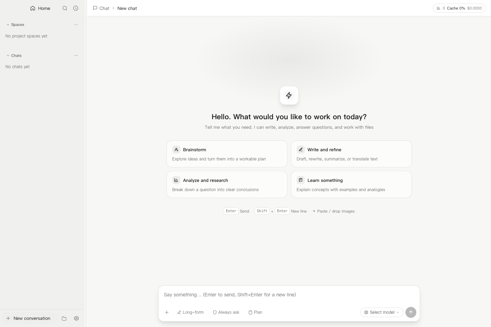
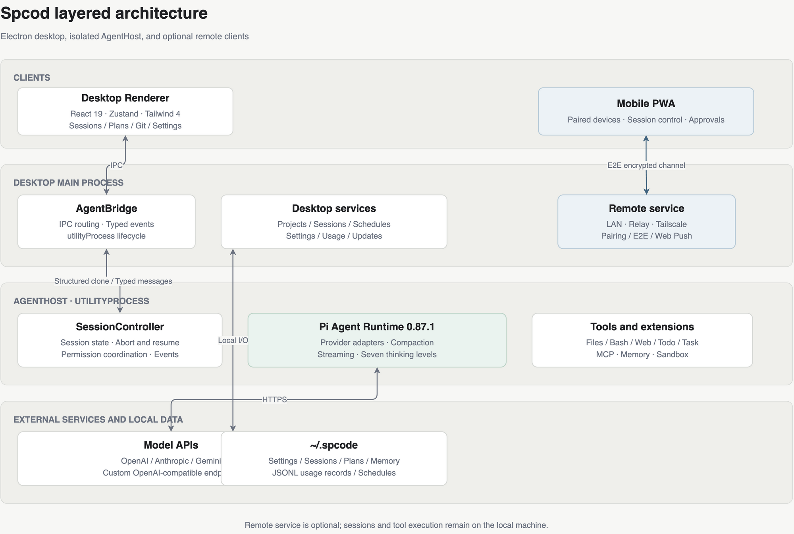
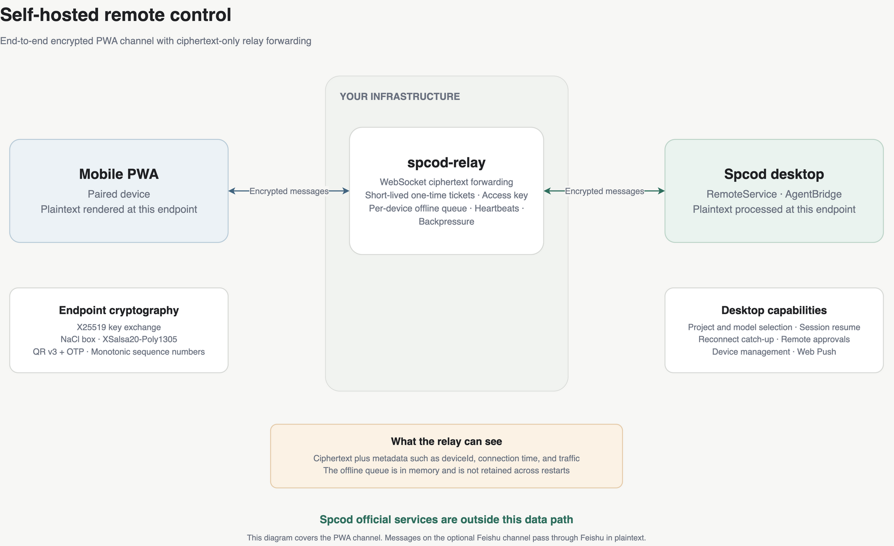
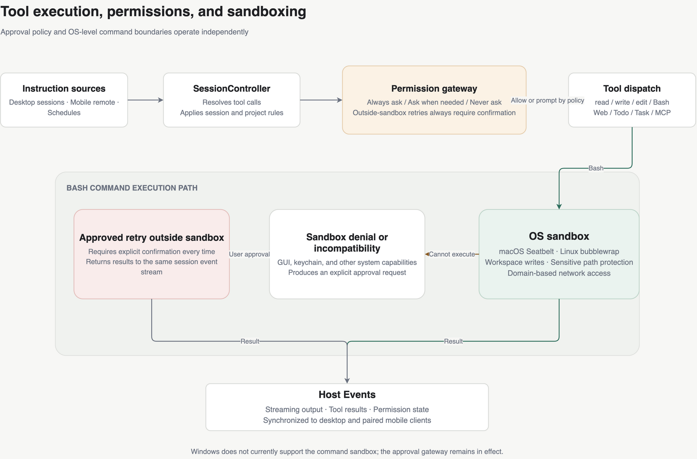

# Spcod Harness

[中文](README.md) · **English**

An Agentic Code desktop workspace powered by [Pi](https://github.com/earendil-works/pi). Spcod brings project sessions, tool execution, planning, permission approvals, and remote control into one desktop interface for macOS and Windows.

[Download](https://github.com/spcodhu/Spcode/releases) · [Self-hosted relay](https://github.com/spcodhu/spcod-relay) · [Remote control design](docs/remote-control-design.md)



## Features

- **Remote control**: The mobile PWA provides session streaming, project and model selection, schedules, permission approvals, and multi-device management over LAN, a public relay, or Tailscale, with Web Push support.
- **Self-hosted data path**: The PWA channel uses X25519 and NaCl box end-to-end encryption. With your own relay, Spcod official services stay outside the data path.
- **Development workflow**: Chat and project modes, plan mode, Git diff, stash restoration, full-text search, session fork, and export.
- **Agent tools**: read / write / edit / Bash / grep / find / ls, WebSearch, WebFetch, TodoWrite, AskUserQuestion, Task subagents, and MCP.
- **Long-running tasks**: Steer, abort and resume, automatic context compaction, layered memory, and post-session distillation.
- **Models and usage**: Custom models and OpenAI-compatible endpoints, seven thinking levels, token/cache/cost statistics, and provider quota cards.
- **Desktop experience**: Light and dark themes, theme and local font import, image attachments, desktop notifications, network proxies, Chinese and English interfaces, and automatic updates.

## Architecture

The Renderer uses React 19, Zustand, and Tailwind 4. The Electron main process manages local services and remote connections. `AgentBridge` exchanges typed messages with AgentHost in a `utilityProcess` through structured cloning. AgentHost runs Pi 0.87.1 and handles model calls, session state, and tool execution.



## Getting started

### Install a release

Download a macOS or Windows build from [GitHub Releases](https://github.com/spcodhu/Spcode/releases). macOS builds are currently unsigned with an Apple Developer certificate. If Gatekeeper blocks the app, run:

```bash
xattr -cr /Applications/Spcod.app
```

After the first launch, configure a model provider API key under **Settings → Models**.

### Run from source

Node.js 22.19 or later and pnpm 9 are required.

```bash
pnpm install
pnpm dev
```

## Self-hosted remote control



1. Deploy [spcod-relay](https://github.com/spcodhu/spcod-relay) on your own server with Docker or Node.js 22.19+.
2. For public deployments, enable TLS through a reverse proxy to obtain a `wss://` URL. Setting `RELAY_ACCESS_KEY` is recommended.
3. On the desktop, open **Settings → Remote control**, enable the service, select **Self-hosted**, and enter the relay URL and access key.
4. Generate a pairing code, scan the QR code with your phone, and enter the OTP. Select **LAN only** for devices on the same network.

The relay forwards ciphertext and can see metadata such as deviceId, connection time, and traffic. Its offline queue is held in memory and cleared on restart. See the [self-hosting guide](https://github.com/spcodhu/spcod-relay/blob/master/docs/SELF_HOSTING.md) for full configuration.

> The optional Feishu bot channel is disabled by default. Messages pass through Feishu in plaintext and are outside the PWA end-to-end encrypted channel.

## Permissions and sandboxing

Permission modes control approval behavior, while the sandbox controls the operating-system boundaries for Bash commands. **Always ask**, **Ask when needed**, and **Never ask** can be selected per session. Frequently used commands can be saved as project-level approval rules.

macOS uses Seatbelt and Linux uses bubblewrap, with workspace write restrictions, sensitive path protection, and domain-based network controls. Retrying outside the sandbox always requires confirmation. Windows currently uses the approval gateway without command sandboxing.



See [permission modes](docs/permission-modes.md) and [command sandboxing](docs/sandbox.md) for detailed behavior. These documents are currently written in Chinese.

## Development

```bash
pnpm dev                                      # Electron development mode with HMR
pnpm typecheck                                # Type-check all workspaces
pnpm test                                     # Vitest unit tests
pnpm build                                    # Production build
pnpm --filter @spcode/desktop test:e2e        # Playwright E2E tests
pnpm --filter @spcode/desktop dist:mac        # macOS dmg + zip
pnpm --filter @spcode/desktop dist:win        # Windows NSIS + zip
```

E2E tests use a temporary `SPCODE_HOME` and an isolated Electron data directory. They do not read or modify your actual `~/.spcode/`.

## Data directory

```text
~/.spcode/
├── settings.json       Settings, permission rules, and remote configuration
├── sessions.json       Session registry
├── schedules.json      Scheduled tasks
├── SOUL.md             Long-term persona and behavior conventions
├── USER.md MEMORY.md   User information and long-term memory
├── memory/             Daily logs, lessons, and project memory
├── usage/*.jsonl       Token and cost records
├── plans/              PLAN.md files created by plan mode
├── fonts/              Imported fonts
├── remote/             Pairing keys and remote state
├── agent/              Pi engine data, credentials, and session files
└── scratch/            Working directory for chat mode
```

## Documentation

- [Remote control design](docs/remote-control-design.md)
- [Remote security checklist](docs/remote-security-checklist.md)
- [Permission modes](docs/permission-modes.md)
- [Command sandboxing](docs/sandbox.md)
- [Network proxy](docs/network-proxy.md)
- [Plan mode](docs/plan-mode-design.md)
- [Feishu channel setup](docs/feishu-setup.md)

The detailed design documents are currently written in Chinese.

## Technology stack

TypeScript · pnpm monorepo · Electron 44 · React 19 · Zustand · Tailwind 4 · Pi 0.87.1 · Streamdown · electron-builder · electron-updater
