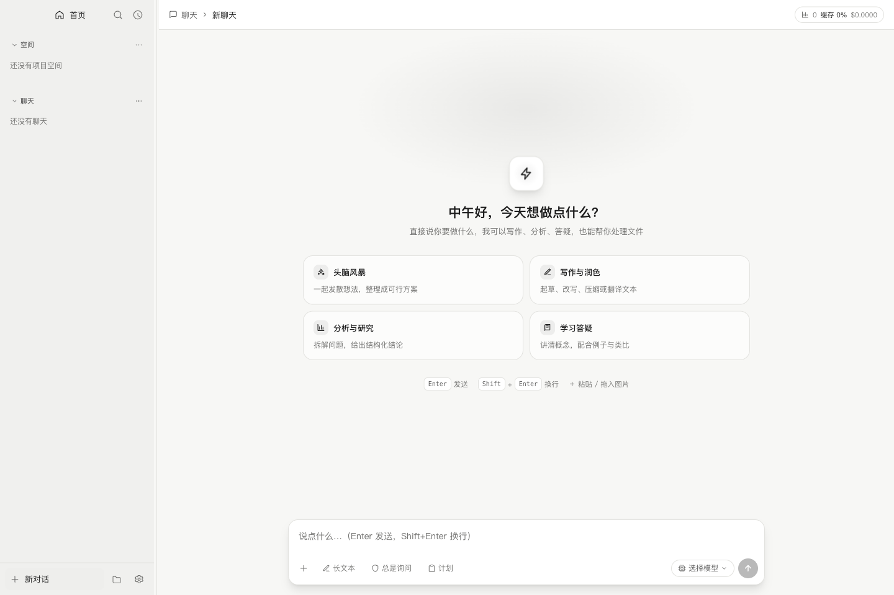
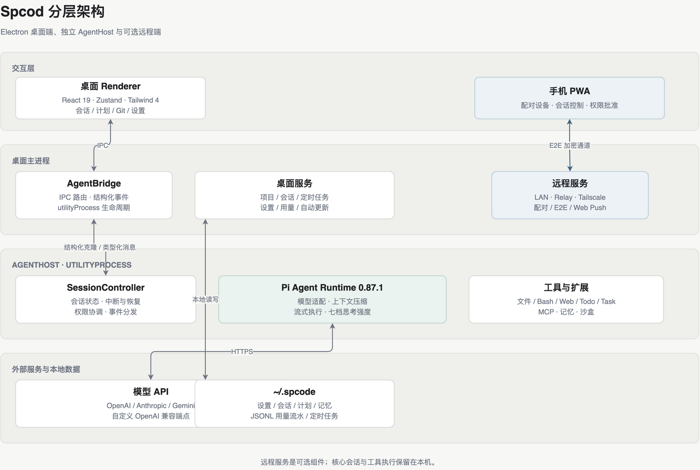
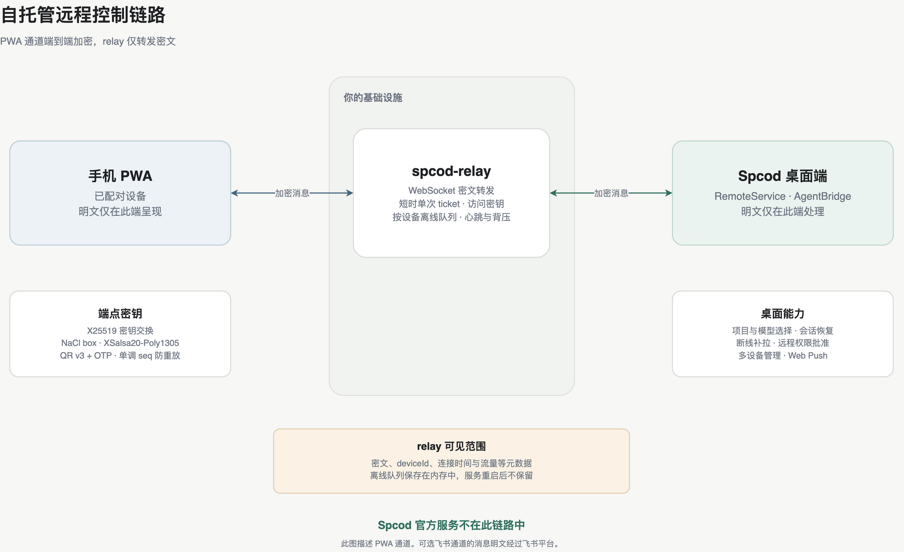
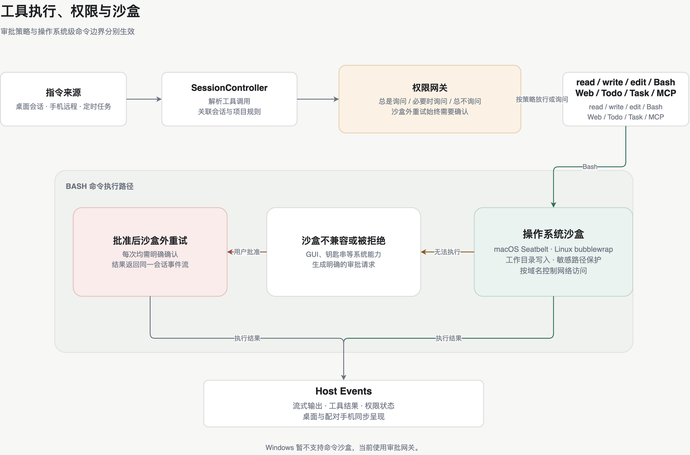

# Spcod Harness

**中文** · [English](README.en.md)

以 [Pi](https://github.com/earendil-works/pi) 为引擎的 Agentic Code 桌面工作台。Spcod 将项目会话、工具执行、计划、权限审批和远程控制整合到同一套桌面界面中，支持 macOS 和 Windows。

[下载安装包](https://github.com/spcodhu/Spcode/releases) · [自托管 relay](https://github.com/spcodhu/spcod-relay) · [远程控制设计](docs/remote-control-design.md)



## 核心功能

- **远程控制**：手机 PWA 支持会话流、项目与模型选择、定时任务、权限批准和多设备管理；提供局域网、公网 relay、Tailscale 和 Web Push。
- **自托管数据路径**：PWA 通道使用 X25519 与 NaCl box 端到端加密。部署自己的 relay 后，Spcod 官方不参与数据转发。
- **开发工作流**：聊天与项目双模式、计划模式、Git diff、stash 还原、全文搜索、会话 Fork 与导出。
- **Agent 工具**：read / write / edit / Bash / grep / find / ls、WebSearch、WebFetch、TodoWrite、AskUserQuestion、Task 子代理和 MCP。
- **长任务管理**：运行中插话、中断与恢复、自动上下文压缩、分层记忆和会话结束蒸馏。
- **模型与用量**：自定义模型和 OpenAI 兼容端点、七档思考强度、Token / 缓存 / 成本统计及供应商配额卡片。
- **桌面体验**：亮暗主题、主题与本地字体导入、图片附件、桌面通知、网络代理、中英文界面和自动更新。

## 架构

Renderer 使用 React 19、Zustand 和 Tailwind 4。Electron 主进程管理本地服务和远程连接，`AgentBridge` 通过结构化克隆与 `utilityProcess` 中的 AgentHost 交换类型化消息。AgentHost 基于 Pi 0.87.1，负责模型调用、会话状态和工具执行。



## 快速开始

### 下载安装包

从 [GitHub Releases](https://github.com/spcodhu/Spcode/releases) 下载 macOS 或 Windows 版本。macOS 包当前未经过 Apple 开发者签名；如被 Gatekeeper 拦截，可执行：

```bash
xattr -cr /Applications/Spcod.app
```

首次打开后，在「设置 → 模型」中配置任一模型供应商的 API Key。

### 从源码运行

要求 Node.js 22.19 或更高版本，包管理器使用 pnpm 9。

```bash
pnpm install
pnpm dev
```

## 自托管远程控制



1. 在自己的服务器部署 [spcod-relay](https://github.com/spcodhu/spcod-relay)，支持 Docker 和 Node.js 22.19+。
2. 公网部署时通过反向代理启用 TLS，得到 `wss://` 地址，并建议配置 `RELAY_ACCESS_KEY`。
3. 在桌面端打开「设置 → 远程控制」，启用服务并选择「自托管」，填写 relay 地址和访问密钥。
4. 生成配对码，用手机扫描二维码并输入 OTP。只在同一网络使用时可以选择「仅局域网」。

relay 只转发密文，可见 deviceId、连接时间和流量等元数据。离线队列保存在内存中，重启后不保留。完整配置见 [自托管指南](https://github.com/spcodhu/spcod-relay/blob/master/docs/SELF_HOSTING.md)。

> 可选飞书机器人通道默认关闭，消息明文经过飞书平台，不属于 PWA 通道的端到端加密链路。

## 权限与沙盒

权限模式决定审批策略，沙盒决定 Bash 命令的操作系统边界。三档模式为「总是询问」「必要时询问」「总不询问」，按会话生效；常用命令可以保存为项目级免审批规则。

macOS 使用 Seatbelt，Linux 使用 bubblewrap，支持工作目录写入限制、敏感路径保护和网络域名控制。沙盒外重试始终需要确认。Windows 暂不支持命令沙盒，当前使用审批网关。



详细行为见 [权限模式](docs/permission-modes.md) 和 [命令沙盒](docs/sandbox.md)。

## 开发

```bash
pnpm dev                                      # Electron 开发模式与 HMR
pnpm typecheck                                # 全部工作区类型检查
pnpm test                                     # Vitest 单元测试
pnpm build                                    # 生产构建
pnpm --filter @spcode/desktop test:e2e        # Playwright E2E
pnpm --filter @spcode/desktop dist:mac        # macOS dmg + zip
pnpm --filter @spcode/desktop dist:win        # Windows NSIS + zip
```

E2E 使用临时 `SPCODE_HOME` 和独立 Electron 数据目录，不读写真实的 `~/.spcode/`。

## 数据目录

```text
~/.spcode/
├── settings.json       设置、权限规则和远程配置
├── sessions.json       会话注册表
├── schedules.json      定时任务
├── SOUL.md             长期人格与行为约定
├── USER.md MEMORY.md   用户信息与长期记忆
├── memory/             每日日志、lessons 和项目记忆
├── usage/*.jsonl       Token 与成本流水
├── plans/              计划模式的 PLAN.md
├── fonts/              导入的字体
├── remote/             配对密钥与远程状态
├── agent/              Pi 引擎数据、认证和会话文件
└── scratch/            聊天模式工作目录
```

## 文档

- [远程控制设计](docs/remote-control-design.md)
- [远程安全检查清单](docs/remote-security-checklist.md)
- [权限模式](docs/permission-modes.md)
- [命令沙盒](docs/sandbox.md)
- [网络代理](docs/network-proxy.md)
- [计划模式](docs/plan-mode-design.md)
- [飞书通道配置](docs/feishu-setup.md)

## 技术栈

TypeScript · pnpm monorepo · Electron 44 · React 19 · Zustand · Tailwind 4 · Pi 0.87.1 · Streamdown · electron-builder · electron-updater
