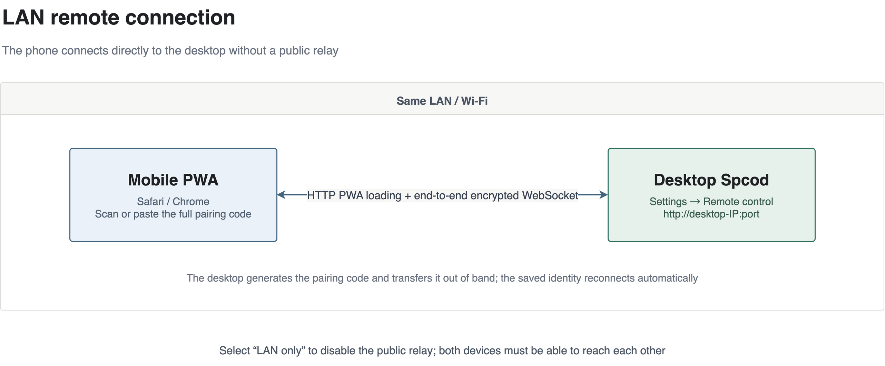
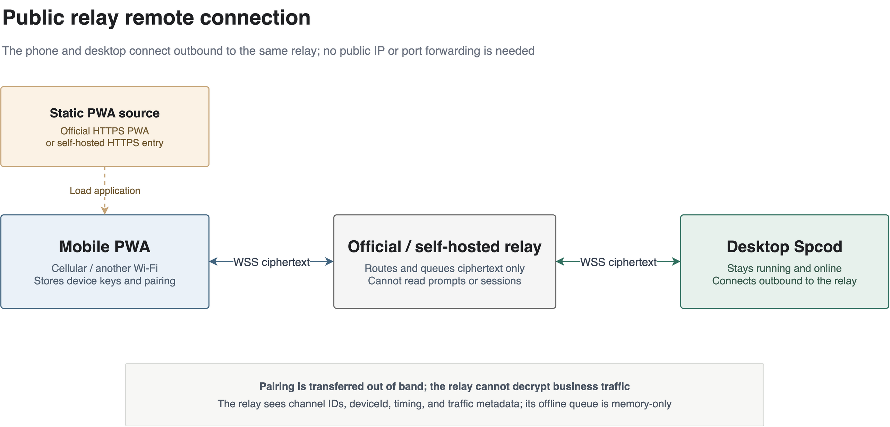

# Spcod Remote Connection Guide: LAN and Public Networks

[中文](remote-connection.md) · **English**

This guide explains how to connect a mobile browser to Spcod running on your desktop. No native mobile app is required. Command-line access is only needed if you choose to self-host the relay or public PWA.

Remote control is disabled by default. After pairing, the phone can display sessions, send instructions, answer questions, approve permission requests, and manage scheduled tasks.

## Choose a connection mode

| Mode | When to use it | Server deployment | Data path |
| --- | --- | --- | --- |
| LAN direct | The phone and desktop are on the same Wi-Fi or LAN | Not required | Phone ↔ desktop |
| Public official relay | The phone uses cellular data or another network, with zero deployment | Not required | Phone ↔ official relay ↔ desktop |
| Public self-hosted relay | You want to control the relay and data path yourself | Your server is required | Phone ↔ your relay ↔ desktop |

If both devices already belong to the same tailnet, the desktop also supports **Tailscale direct connection**. This private-network option is outside the two main LAN and public-relay paths covered by this guide.

In every mode, Spcod must remain running and online on the desktop. A relay does not manage or wake the desktop. The phone cannot control the computer while it is powered off, asleep, or Spcod has exited.

## Common preparation

1. Update Spcod and the mobile client to the latest version.
2. On the desktop, open **Settings → Remote control**.
3. Use a modern mobile browser such as Safari or Chrome. A camera is optional because the full pairing payload can be pasted instead.
4. Understand the pairing rules:
   - A QR code and its full pairing payload are valid for **5 minutes and one successful use**. Generate a new one after expiry or successful use.
   - The **8-digit OTP is already embedded in the QR code and full payload**. It is for verification and cannot be entered alone to pair a phone.
   - Five consecutive pairing failures cause a 10-minute lockout. Wait for the lockout to end before generating another payload and retrying.
5. Pairing records are stored in IndexedDB for the current browser and site origin. **Changing browsers, domains, addresses, or ports, or clearing site data, can require pairing again.** Choose the long-term mobile entry point before pairing whenever possible.

---

## Part 1: LAN remote connection



LAN mode does not connect to a public relay. The phone accesses an address provided directly by the desktop, making it suitable for a shared home or office network.

### How it works: the desktop serves both the page and direct channel

The desktop uses one port for two capabilities: HTTP serves the static mobile PWA, while the `/ws` WebSocket endpoint carries pairing and business messages. The pairing code contains the desktop public key, available addresses, and a one-time OTP. The phone generates its own key pair during pairing, and subsequent business messages are end-to-end encrypted between the two devices. No public server participates in this workflow.

### 1. Put the phone and desktop on the same LAN

Connect the phone to the same Wi-Fi or LAN as the desktop. Guest Wi-Fi, enterprise client isolation, and router AP isolation can block device-to-device access. Use a public relay if those restrictions cannot be changed.

### 2. Enable the desktop service

1. Open **Settings → Remote control**.
2. Turn on **Enable remote control**.
3. Under **Public relay**, select **LAN only**. The desktop will not establish a public relay connection in this mode.
4. Wait for **Listening addresses** to appear. They look like:

   ```text
   http://192.168.1.100:8123
   ```

   Use the actual IP address and port shown on your desktop, not this example.

The port is saved after the first successful launch and remains stable across desktop restarts. Avoid **Change port** unless necessary: the address and port form the mobile site's origin, so changing them can require pairing again.

### 3. Open the PWA on the phone

Open one of the desktop **Listening addresses** in the mobile browser. The **Connect to Spcod on desktop** pairing page should appear.

> Plain LAN HTTP supports basic remote control, but browsers commonly block camera access and may restrict Web Push and Add to Home Screen. If scanning is unavailable, use the full pairing payload below.

### 4. Generate a payload and pair

1. Under **Pair a new device** on the desktop, click **Generate pairing code**.
2. Enter a recognizable device name on the phone, such as “My iPhone”.
3. Choose one pairing method:
   - **Scan**: tap **Scan to pair**, grant camera access, and scan the desktop QR code.
   - **Manual**: click **Copy full pairing code** on the desktop. Transfer the entire `spcode-remote://pair?…` value to the phone through a trusted channel, paste it into the text area, and tap **Connect with pairing code**.
4. After pairing, the phone opens the session list and the device appears under **Paired devices** on the desktop.

Do not send only the 8-digit OTP to the phone. Manual pairing requires the complete payload.

### 5. Reconnect and unpair

- Reopen the PWA at the same listening address in the same browser. The saved device identity authenticates automatically without another QR scan.
- The phone tries LAN addresses first. If the pairing payload also contains a relay, it tries the relay only after all direct connections fail.
- On the desktop, use **Unpair** under **Paired devices** to revoke a device. The mobile session list also provides an unpair action in its footer.
- If the phone says the desktop removed the device, choose to pair again and use a new QR code.

### LAN troubleshooting

| Symptom | What to check |
| --- | --- |
| The listening address does not open | Keep remote control enabled, verify both devices are on the same network, allow inbound Spcod connections in the desktop firewall, and check for client/AP isolation. |
| The page opens but scanning does not | Browsers may disable the camera on HTTP. Use **Copy full pairing code → paste on the phone → Connect with pairing code**. |
| Pairing stops working after a port change | Open the PWA at the new listening address. Pair again if the new origin has no saved pairing record. |
| The phone disconnects after leaving the LAN | This is expected for direct LAN mode. Configure a public relay as described below for cross-network access. |

---

## Part 2: Public remote connection



In public mode, both the desktop and phone make outbound connections to the same relay. Neither the desktop nor the phone needs a public IP address or router port forwarding. The pairing payload contains available LAN addresses and the relay channel; the phone prefers direct connections and falls back to the relay.

### How it works: public PWA hosting and the encrypted relay have separate roles

- **The public PWA address**, `https://spcod-relay.hlt.cab/`, loads the pairing page and encryption client directly on the phone. It is not the desktop address and does not require the phone to join the LAN first.
- **The relay address**, `wss://spcod-relay.hlt.cab`, forwards ciphertext. The desktop and phone each make an outbound connection to the same relay channel, so the desktop needs neither a public IP nor router port forwarding.
- **The pairing code** contains the desktop public key, a one-time OTP, and a `relay+wss://…` channel. The phone generates its own key pair and protects the pairing request with an OTP-derived key; the plaintext OTP does not pass through the relay. After pairing, both devices save the device identity and use X25519 with NaCl box for end-to-end encrypted business traffic.

### Option A: Use the official relay without deploying a server

The official PWA is `https://spcod-relay.hlt.cab/` and the official relay is `wss://spcod-relay.hlt.cab`. No account or access key is required.

#### 1. Enable the official relay on the desktop

1. Open **Settings → Remote control** and turn on **Enable remote control**.
2. Under **Public relay**, select **Official relay**.
3. Confirm that `wss://spcod-relay.hlt.cab` is displayed and the state becomes **Connected**.
4. Optionally click **Test connection** to check the health endpoint before pairing.

New installations default to the official relay. An older installation configured as **LAN only** retains that setting after an upgrade, so switch it to **Official relay** manually. At the same mobile origin, an old official pairing without an access key migrates automatically to the current official address during a cold start, without another QR scan.

#### 2. Open the public PWA directly on the phone

The phone can use cellular data or another Wi-Fi network; it does not need to share the desktop's network. Open this address directly in its browser:

```text
https://spcod-relay.hlt.cab/
```

The **Connect to Spcod on desktop** pairing page should appear. This public address distributes only the static mobile client. Hosting the PWA does not turn your session content into plaintext.

#### 3. Pair directly in the public PWA

1. Keep the desktop at **Official relay → Connected**.
2. Generate a pairing code under **Pair a new device**.
3. Tap **Scan to pair** on the phone and scan the desktop QR code. If the camera is unavailable, click **Copy full pairing code** on the desktop, transfer the entire `spcode-remote://pair?…` value through a trusted channel, paste it on the phone, and tap **Connect with pairing code**.
4. Wait for the session list to appear and verify that the phone appears under **Paired devices** on the desktop.

The entire pairing exchange can run over the public relay. **There is no need to join the LAN first or switch networks after pairing.**

#### 4. Verify and reconnect later

1. Keep the desktop and Spcod running, with the relay state **Connected**.
2. Refresh the session list or open an existing session in the public PWA.
3. After closing the page, reopen `https://spcod-relay.hlt.cab/` in the same browser. The saved device identity authenticates automatically without another pairing.
4. In a paired PWA, open **Settings → Relay server** and choose **Official / Self-hosted / LAN only**. Saving rebuilds the connection without actively unpairing the device; the device identity and existing page data are retained.

### Option B: Use a self-hosted relay

Self-hosting gives you control over the relay. Business messages remain end-to-end encrypted between the phone and desktop. The relay access key controls server admission; it is not the end-to-end encryption private key.

#### 1. Deploy the relay with HTTPS/WSS

Prepare a Linux server, Docker Engine 24+, Docker Compose 2.20+, and a domain. Point the domain's A/AAAA records at the server and allow TCP ports 80 and 443 in both the cloud security group and host firewall.

Run on the server:

```bash
git clone https://github.com/spcodhu/spcod-relay.git
cd spcod-relay
./deploy.sh --check
./deploy.sh --domain relay.example.com
```

Replace `relay.example.com` with your domain. The script generates a random access key, builds and starts the relay and Caddy, and requests an HTTPS certificate automatically. Save the displayed access key, then verify:

```bash
curl --fail https://relay.example.com/health
# Expected: {"ok":true,"version":2}
```

See the [spcod-relay deployment guide](https://github.com/spcodhu/spcod-relay/blob/master/docs/DEPLOYMENT.en.md) for complete installation, update, and operations instructions.

#### 2. Configure the desktop

1. Open **Settings → Remote control → Public relay → Self-hosted**.
2. Enter `wss://relay.example.com` as the relay URL, without `/health` or another path.
3. Enter the **Relay access key** printed by the deployment script.
4. Click **Save**, then **Test connection**.
5. Confirm the **Connected** state and generate a pairing code.

> A self-hosted pairing payload includes the relay access key. If the desktop warns that the QR code contains this key, do not share the QR code, screenshots, or full payload in group chats or public channels.

#### 3. Open the public PWA and pair, or change an existing pairing

- **New device**: first open `https://spcod-relay.hlt.cab/` or your own HTTPS PWA on the phone. Generate the payload while the desktop is connected to the self-hosted relay, then scan or paste it on the phone. The relay URL and access key are included automatically.
- **Existing paired device**: open **Settings → Relay server → Self-hosted** in the mobile PWA. Enter the same `wss://` URL and access key, then tap **Test connection** and **Save**. This does not unpair the device.

The desktop and phone must use the same relay instance. A different URL, access key, or origin allowlist will prevent the connection. When using the official PWA with your self-hosted relay, add the complete official PWA origin to `deploy/relay.env` on your server:

```dotenv
CORS_ALLOWED_ORIGINS=https://spcod-relay.hlt.cab
```

Run `./deploy.sh` again after changing this setting.

#### 4. Optional: self-host the mobile PWA as well

If you want your own domain to serve the mobile page too, the simplest option is to serve it from the same origin as your relay:

1. Build the mobile client from the Spcod harness source directory:

   ```bash
   pnpm install --frozen-lockfile
   pnpm --filter @spcode/mobile build
   ```

   The output is written to `apps/mobile/dist/`.

2. Upload that directory to the server, make the directory and its files readable by the container's `node` user, and add a read-only mount to the `relay` service in `spcod-relay/deploy/docker-compose.yml`:

   ```yaml
   services:
     relay:
       volumes:
         - /absolute/path/mobile-dist:/app/public:ro
   ```

3. Run `./deploy.sh` again from the relay project, then open `https://relay.example.com/`. It should show the mobile pairing page instead of the “PWA is not hosted” notice.
4. Pair through this HTTPS address and keep using the same entry point. No additional CORS configuration is needed when the PWA and relay share an origin. Browser mixed-content rules may prevent the HTTPS page from using an HTTP LAN address in the pairing payload; falling back to the WSS relay is expected and does not affect public use.

If the PWA is hosted on another HTTPS domain, put its complete origin in `deploy/relay.env` and redeploy:

```dotenv
CORS_ALLOWED_ORIGINS=https://app.example.com
```

Do not use a path or wildcard. Changing the PWA domain creates a new origin. Existing pairing records are not copied across origins, so pair again at the new entry point.

### Public-network troubleshooting

| Symptom | What to check |
| --- | --- |
| Desktop relay remains “Connecting” or “Connection failed” | Verify desktop access to the relay. For the official service, open `https://spcod-relay.hlt.cab/health`. For self-hosting, check `https://your-domain/health`, DNS, TLS, ports 80/443, and proxy settings. |
| Desktop shows “Key authentication failed” | Recheck the self-hosted URL and access key, save, and test again. HTTP 401/403 usually means an invalid key or denied access. |
| The phone reports an invalid or unavailable relay | Use `wss://` on public networks and omit the `/health` path. Verify that the phone can reach the same relay and uses the correct access key. |
| A self-hosted PWA reports an invalid relay key or connection failure even though the key is correct | Add the complete PWA origin to `CORS_ALLOWED_ORIGINS`, save, and run the deployment script again. Origin rejection can also surface as HTTP 401/403. |
| The pairing payload expired, was used, or is invalid | Generate a new desktop payload and use the latest QR code or full value. |
| Pairing is locked | The failure limit was reached. Wait for the 10-minute lockout to end, then generate a new payload and pair again. |
| The phone says the desktop is too old | Upgrade desktop Spcod and reconnect; do not clear the pairing first. |
| Public access fails but Wi-Fi works | Check that the desktop relay is connected, the saved payload includes a relay channel, and the phone is not set to **LAN only** mode. |
| The page cannot reopen after being closed off-LAN | Reopen the same public HTTPS PWA address in the same browser. If it displays a “does not host the mobile PWA” notice, static hosting has not been deployed on that instance; this is not a pairing-code problem. |
| Offline messages disappear after a relay restart | The relay queue is memory-only and is cleared on restart. Clients reconcile through authoritative snapshots and backfill after reconnecting, but the relay is not a persistent message database. |

## Security and privacy boundaries

- Traffic between the phone and desktop uses X25519 and NaCl box end-to-end encryption. The relay forwards ciphertext and cannot read code, prompts, session content, or scheduled task content.
- The relay can still see metadata such as channel identifiers, deviceId, connection times, and traffic volume. With a self-hosted relay, official Spcod services are outside your forwarding path.
- The official relay needs no access key. A self-hosted access key is exchanged for short-lived, single-use tickets and should not appear in WebSocket URLs.
- Treat pairing payloads and OTPs as sensitive. Payloads containing a self-hosted access key require particular care.
- Web Push is disabled by default and notifications contain no task data. Camera access, push, and Add to Home Screen may be restricted on LAN HTTP origins.

## Related documentation

- [Remote control design](remote-control-design.md)
- [Remote security checklist](remote-security-checklist.md)
- [spcod-relay deployment guide](https://github.com/spcodhu/spcod-relay/blob/master/docs/DEPLOYMENT.en.md)
- [spcod-relay self-hosting and runtime configuration](https://github.com/spcodhu/spcod-relay/blob/master/docs/SELF_HOSTING.md)
