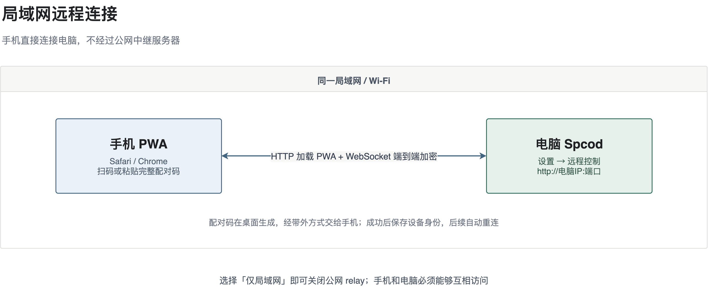
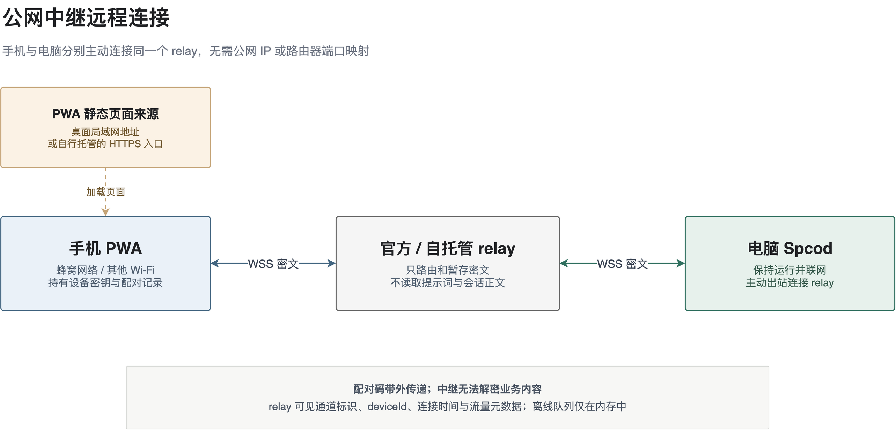

# Spcod 远程连接教程：局域网与公网

**中文** · [English](remote-connection.en.md)

本教程面向使用 Spcod 安装版的普通用户，说明如何用手机浏览器连接电脑上的 Spcod。无需安装原生 App，也无需在手机或电脑上使用终端；只有选择自托管中继或自行托管公网 PWA 时才需要操作服务器。

远程控制默认关闭。配对成功后，手机可以查看会话、发送指令、回复提问、批准权限请求和管理定时任务。

## 选择连接方式

| 方式 | 适用场景 | 需要部署服务器 | 数据路径 |
| --- | --- | --- | --- |
| 局域网直连 | 手机与电脑在同一 Wi-Fi 或局域网 | 不需要 | 手机 ↔ 电脑 |
| 公网官方中继 | 手机使用蜂窝网络或其他网络，希望零部署 | 不需要 | 手机 ↔ 官方 relay ↔ 电脑 |
| 公网自托管中继 | 希望自己控制中继和数据路径 | 需要一台服务器 | 手机 ↔ 你的 relay ↔ 电脑 |

如果两台设备已经加入同一个 tailnet，也可以在桌面端使用 **Tailscale 直连**。它属于私有网络直连方案，不在本教程的局域网与公网中继两条主线内展开。

无论使用哪种方式，电脑上的 Spcod 都必须保持运行并联网。中继不是电脑开关机或桌面端管理服务，电脑关机、休眠或退出 Spcod 后，手机无法继续控制它。

## 开始前的共同准备

1. 将电脑和手机端的 Spcod 更新到最新版本。
2. 在电脑打开 **设置 → 远程控制**。
3. 手机使用 Safari、Chrome 等现代浏览器。摄像头不是必需品，因为可以粘贴完整配对码。
4. 阅读下面的配对规则，避免把 OTP 当作独立密码使用：
   - 配对二维码和完整配对码 **5 分钟内有效，只能成功使用一次**；过期或已使用后，在桌面端重新生成。
   - 页面上的 **8 位 OTP 已经包含在二维码和完整配对码中**，仅供核对，不能单独输入手机完成配对。
   - 连续 5 次配对失败会锁定 10 分钟；等待锁定结束后重新生成配对码。
5. 配对记录保存在当前浏览器、当前站点地址（origin）的 IndexedDB 中。**更换浏览器、域名、地址或端口，以及清除站点数据，都可能导致需要重新配对。** 建议一开始就确定以后长期使用的手机入口。

---

## 第一部分：局域网远程连接



局域网模式不连接公网 relay，手机直接访问电脑提供的地址。适合手机与电脑在同一家庭或办公室网络中使用。

### 原理：电脑同时提供页面和直连通道

桌面端在同一个端口提供两种能力：HTTP 用来加载手机 PWA 静态页面，`/ws` WebSocket 用来传输配对和业务消息。配对码包含桌面公钥、可用地址和一次性 OTP；手机生成自己的密钥对后完成配对，之后的业务消息在两端之间端到端加密。此流程不经过公网服务器。

### 1. 让手机与电脑进入同一局域网

将手机连接到电脑正在使用的 Wi-Fi 或局域网。访客 Wi-Fi、企业网络的客户端隔离，以及部分路由器的 AP 隔离可能阻止设备互访；遇到这些问题时可改用公网中继。

### 2. 在桌面端启用服务

1. 打开 **设置 → 远程控制**。
2. 打开 **启用远程控制**。
3. 在 **公网中继** 中选择 **仅局域网**。这样桌面端不会建立公网 relay 连接。
4. 等待 **监听地址** 出现，通常为：

   ```text
   http://192.168.1.100:8123
   ```

   实际 IP 和端口以你的页面为准，不要照抄示例。

首次成功启用后，端口会自动固定，桌面重启不会随机变化。不要随意点击 **更换端口**：地址和端口是手机站点 origin 的一部分，变化后可能需要重新配对。

### 3. 用手机打开 PWA

在手机浏览器中打开桌面显示的一个 **监听地址**。如果手机能打开页面，就会进入 **连接到桌面 Spcod** 配对页。

> 普通局域网 HTTP 可以完成基本远程控制，但浏览器通常会禁止它调用摄像头，也可能限制 Web Push 和添加到主屏幕。扫码不可用时，直接使用下面的完整配对码即可。

### 4. 生成配对码并完成配对

1. 在桌面端找到 **配对新设备**，点击 **生成配对码**。
2. 在手机配对页填写可识别的设备名，例如“我的 iPhone”。
3. 选择一种配对方式：
   - **扫码**：点击手机页面的 **扫码配对**，允许摄像头权限，然后扫描桌面二维码。
   - **手动配对**：在桌面端点击 **复制完整配对码**，通过可信方式把整段 `spcode-remote://pair?…` 发到手机；粘贴到手机文本框，点击 **使用配对码连接**。
4. 配对成功后，手机自动进入会话列表。桌面的 **已配对设备** 中也会出现这台手机。

不要只把桌面显示的 8 位 OTP 发给手机；手动配对必须使用完整配对码。

### 5. 后续重连与解除配对

- 在同一浏览器中使用同一监听地址重新打开 PWA，手机会使用已保存的身份自动认证，不需要再次扫码。
- 手机会优先尝试局域网地址；如果配对码还包含 relay 地址，局域网连接全部失败后才尝试 relay。
- 在桌面 **已配对设备** 中点击 **解除配对**，可撤销对应设备。手机端会话列表底部也提供解除配对入口。
- 如果手机提示“桌面端已移除本设备”，点击重新配对并扫描新二维码。

### 局域网故障排查

| 现象 | 检查与处理 |
| --- | --- |
| 手机打不开监听地址 | 确认桌面远程控制仍开启；确认手机与电脑在同一网络；检查电脑防火墙是否允许 Spcod 接收入站连接；检查路由器是否开启客户端/AP 隔离。 |
| 页面能打开，但不能扫码 | HTTP 下浏览器可能禁用摄像头。改用 **复制完整配对码 → 手机粘贴 → 使用配对码连接**。 |
| 更换端口后原配对失效 | 使用新监听地址打开 PWA；新 origin 没有旧浏览器的配对记录时，重新配对。 |
| 手机离开局域网后断开 | 这是局域网直连的预期行为。需要跨网络使用时，配置下面的公网中继。 |

---

## 第二部分：公网远程连接



公网模式让桌面端主动连接 relay，手机也连接同一个 relay。两端不需要公网 IP，也不需要给电脑配置端口映射。配对码会同时携带可用的局域网地址和 relay 通道，手机优先直连，直连不可用时走 relay。

### 原理：公网页面与加密 relay 分工

- **公网 PWA 地址** `https://spcod-relay.hlt.cab/` 负责让手机直接加载配对页面和加密客户端；它不是电脑地址，也不要求手机先进入局域网。
- **relay 地址** `wss://spcod-relay.hlt.cab` 负责转发密文。电脑和手机分别主动连接 relay 的同一通道，不需要电脑有公网 IP，也不需要路由器端口映射。
- **配对码**包含桌面公钥、一次性 OTP 和 `relay+wss://…` 通道。手机生成自己的密钥对，用 OTP 派生密钥保护配对请求；OTP 不以明文经过 relay。配对成功后，双方保存设备身份，后续业务消息使用 X25519 与 NaCl box 端到端加密。

### 方案 A：使用官方中继（无需部署服务器）

官方 PWA 地址为 `https://spcod-relay.hlt.cab/`，官方 relay 地址为 `wss://spcod-relay.hlt.cab`，无需账号和访问密钥。

#### 1. 在桌面端启用官方中继

1. 打开 **设置 → 远程控制**，开启 **启用远程控制**。
2. 在 **公网中继** 中选择 **官方中继**。
3. 确认页面显示 `wss://spcod-relay.hlt.cab`，状态变为 **已连接**。
4. 可点击 **测试连接** 检查健康接口；测试通过后再开始配对。

新安装默认选择官方中继；但旧版本中的“仅局域网”配置升级后仍保持原样，需要手动切换为 **官方中继**。在同一手机入口中，无访问密钥的旧官方配对会在冷启动时自动迁移到当前官方地址，无需重新扫码。

#### 2. 手机直接打开公网 PWA

手机使用蜂窝网络或其他 Wi-Fi 均可，不需要与电脑同网。直接用浏览器打开：

```text
https://spcod-relay.hlt.cab/
```

页面应显示 **连接到桌面 Spcod** 配对页。这个公开地址只负责分发静态手机端；你的会话内容不会因为它托管 PWA 就变成明文。

#### 3. 在公网 PWA 中直接配对

1. 保持桌面为 **官方中继 → 已连接**。
2. 在 **配对新设备** 中生成配对码。
3. 手机点击 **扫码配对** 扫描桌面二维码；摄像头不可用时，在桌面点击 **复制完整配对码**，把整段 `spcode-remote://pair?…` 安全地传到手机，粘贴后点击 **使用配对码连接**。
4. 等待手机进入会话列表，并确认桌面 **已配对设备** 出现这台手机。

整个配对过程可以直接走公网 relay，**不需要先连接局域网，也不需要配对后切换网络**。

#### 4. 验证与后续使用

1. 保持电脑和 Spcod 运行，确认桌面 relay 仍为 **已连接**。
2. 在公网 PWA 中刷新会话列表或打开已有会话。
3. 页面关闭后，在同一浏览器中重新打开 `https://spcod-relay.hlt.cab/`，已保存的设备身份会自动认证，无需重新配对。
4. 已配对手机可以在 PWA 的 **设置 → 连接服务器** 中选择 **官方 / 自托管 / 局域网**。保存只重建连接，不会主动解除配对，设备身份和已有页面数据会保留。

### 方案 B：使用自托管中继

自托管适合希望自己控制 relay 的用户。业务消息仍由手机与桌面端到端加密；relay 的访问密钥只是服务器准入凭据，不是端到端加密私钥。

#### 1. 部署 relay 和 HTTPS/WSS

准备一台 Linux 服务器、Docker Engine 24+、Docker Compose 2.20+，以及一个域名。把域名 A/AAAA 记录指向服务器，并在云安全组和防火墙中放行 TCP 80、443。

在服务器执行：

```bash
git clone https://github.com/spcodhu/spcod-relay.git
cd spcod-relay
./deploy.sh --check
./deploy.sh --domain relay.example.com
```

把 `relay.example.com` 换成你的域名。脚本会生成随机访问密钥、构建并启动 relay 和 Caddy，自动申请 HTTPS 证书。保存脚本输出的访问密钥，然后验证：

```bash
curl --fail https://relay.example.com/health
# 应返回：{"ok":true,"version":2}
```

完整安装、更新和运维说明见 [spcod-relay 一键部署教程](https://github.com/spcodhu/spcod-relay/blob/master/docs/DEPLOYMENT.md)。

#### 2. 配置桌面端

1. 打开 **设置 → 远程控制 → 公网中继 → 自托管**。
2. Relay 地址填写 `wss://relay.example.com`，不要附加 `/health` 或其他路径。
3. 填写部署脚本输出的 **服务器访问密钥**。
4. 点击 **保存**，再点击 **测试连接**。
5. 确认状态为 **已连接**，然后生成配对码。

> 自托管配对码会携带 relay 访问密钥。桌面出现“此二维码包含自托管服务器访问密钥”提示时，不要分享二维码、截图或完整配对码到群聊和公开渠道。

#### 3. 打开公网 PWA 并配对，或切换已有配对

- **新设备**：先在手机打开 `https://spcod-relay.hlt.cab/` 或你自己的 HTTPS PWA。在与自托管 relay 已连接的桌面端生成配对码，手机扫码或粘贴完整配对码。配对码会自动带上 relay 地址和访问密钥，无需再手工填写。
- **已配对设备**：打开手机 PWA **设置 → 连接服务器 → 自托管**，填写同一个 `wss://` 地址和访问密钥，依次点击 **测试连接**、**保存**。此操作不会解除配对。

桌面和手机必须连接同一个 relay 实例；地址、访问密钥或 origin 白名单不一致都会导致失败。使用官方 PWA 配对你的自托管 relay 时，把官方 PWA 的完整 origin 加入自托管服务器的 `deploy/relay.env`：

```dotenv
CORS_ALLOWED_ORIGINS=https://spcod-relay.hlt.cab
```

修改后重新运行 `./deploy.sh`。

#### 4. PWA 随 Docker 镜像一键部署

`spcod-relay` 的 Docker 镜像会同时构建 relay 和手机 PWA，并把 PWA 放入 `/app/public`。不需要在本机安装 pnpm、构建手机端、上传目录或手工修改 Compose。

首次部署和后续更新都使用同一套命令：

```bash
git pull
./deploy.sh
```

脚本会重建镜像、启动服务，并同时检查 relay 健康状态和内置配对页。部署后直接打开 `https://relay.example.com/`，即可看到手机配对页；PWA 与 relay 同源时无需额外配置 CORS。

首次构建会下载 Node 基础镜像、固定提交的 Spcod 源码和手机端依赖；后续构建会复用镜像层及 pnpm/corepack 缓存。若服务器访问 Docker Hub 或 npm 较慢，可在 `deploy/relay.env` 中设置 `NODE_IMAGE` 与 `NPM_REGISTRY`，具体缓存与镜像加速方法见 [部署教程](https://github.com/spcodhu/spcod-relay/blob/master/docs/DEPLOYMENT.md#5-配置与更新)。不要在正常更新时使用 `docker builder prune` 或 `--no-cache`，否则会重新下载依赖。

PWA 源码由 relay 仓库 `Dockerfile` 中的 `SPCOD_PWA_REF` 固定到明确的 Spcod 提交。维护者需要升级 PWA 时更新该提交并推送 relay 仓库，官方中继和自托管用户随后都通过同一条 `git pull && ./deploy.sh` 路径更新。

如果把 PWA 托管在其他 HTTPS 域名，在 `deploy/relay.env` 中配置完整 origin，再重新部署：

```dotenv
CORS_ALLOWED_ORIGINS=https://app.example.com
```

不要填写路径或通配符。更换 PWA 域名会产生新的 origin，旧配对记录不会自动跨域复制，需要在新入口重新配对。HTTPS 页面可能因浏览器混合内容限制而无法直连配对码中的 HTTP 局域网地址，此时回退到 WSS relay 即可，不影响公网使用。

### 公网故障排查

| 现象 | 检查与处理 |
| --- | --- |
| 桌面 relay 一直“连接中”或“连接失败” | 确认电脑可访问 relay；官方用户可打开 `https://spcod-relay.hlt.cab/health` 检查服务；自托管用户检查 `https://你的域名/health`、DNS、TLS、80/443 端口和代理。 |
| 桌面提示“密钥认证失败” | 检查自托管地址和访问密钥，重新保存并测试。401/403 通常表示密钥错误或无权限。 |
| 手机提示 relay 地址无效或无法连接 | 公网使用 `wss://`，不要填写 `/health` 路径；确认手机能访问同一 relay，并检查访问密钥。 |
| 自托管 PWA 报 relay 访问密钥无效或无法连接，但密钥确认无误 | 将 PWA 的完整 origin 加入 `CORS_ALLOWED_ORIGINS`，保存后重新运行部署脚本；这类 origin 拒绝也可能表现为 401/403。 |
| 配对码过期、已使用或不正确 | 在桌面重新生成配对码，使用最新二维码或完整配对码。 |
| 配对提示已锁定 | 连续失败已达到限制，等待 10 分钟锁定结束后再重新生成并配对。 |
| 手机提示桌面端版本过旧 | 升级桌面 Spcod 后重连，不要先清除配对。 |
| 外网断开，回到 Wi-Fi 后恢复 | 检查桌面 relay 是否已连接、配对码是否包含 relay 通道，以及手机设置中是否误选了“局域网”。 |
| 外网关闭页面后无法重新打开 | 在同一浏览器重新打开同一个公网 HTTPS PWA 地址。若页面显示“未托管手机端 PWA”，说明该实例尚未部署静态页面，不是配对码问题。 |
| relay 重启后部分离线消息缺失 | relay 离线队列只在内存中，重启会清空。重连后客户端会用权威快照和补拉恢复，但不要把 relay 当作持久化消息数据库。 |

## 安全与隐私边界

- 手机与电脑之间使用 X25519 和 NaCl box 进行端到端加密。relay 只转发密文，无法读取代码、提示词、会话正文或定时任务内容。
- relay 仍能看到通道标识、deviceId、连接时间和流量等元数据。使用自托管 relay 后，官方服务不在你的数据转发路径中。
- 官方中继无需访问密钥；自托管访问密钥用于换取短时单次 ticket，不应写入 WebSocket URL。
- 配对码和 OTP 都应视为敏感信息；包含自托管访问密钥的配对码尤其不能公开。
- Web Push 默认关闭，通知不包含任务内容。局域网 HTTP 下摄像头、推送和添加到主屏幕等浏览器能力可能受限。

## 相关文档

- [远程控制设计](remote-control-design.md)
- [远程安全检查清单](remote-security-checklist.md)
- [spcod-relay 一键部署教程](https://github.com/spcodhu/spcod-relay/blob/master/docs/DEPLOYMENT.md)
- [spcod-relay 自托管与运行配置](https://github.com/spcodhu/spcod-relay/blob/master/docs/SELF_HOSTING.md)
