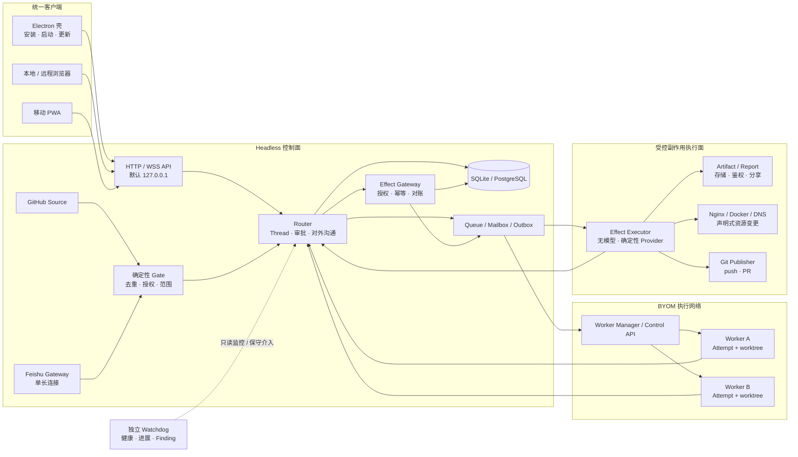

# Spcod Super Agent 产品与两阶段改造方案

> 状态：方案已通过，阶段一代码工作包已完成，进入真实环境联调验收。本文定义产品形态、目标架构、实施范围与验收标准；实现与实测进度见 `docs/super-agent-phase-1-progress.md`。

## 0. 核心结论

Spcod 应从“以 Session 为中心的 Electron 桌面 Agent”演进为：

> **Web 统一工作台 + 可迁移的持久化控制面 + BYOM Worker 执行网络 + 受控 Effect 执行网络。**

本方案坚持五条产品与技术主线：

1. **Web-first，不是 Cloud-only**：新增与改造的工作台能力只维护一套 Web 实现，Electron 和浏览器复用同一页面、API 与事件协议；既有原生 IPC 功能通过适配层渐进迁移，不在浏览器另做一套页面。
2. **本地服务能力与 Electron 解耦**：Super Agent 控制面从第一阶段起运行在独立 headless 进程中；关闭桌面窗口不终止任务，Linux 部署不需要 Electron。
3. **控制面可持续在线，执行面不必全部上云**：本地电脑、团队机器和云 Worker 都是可调度执行节点，充分利用用户已有硬件、代码和工具链。
4. **Agent Loop、主要计算与外部副作用解耦**：Worker 通过结构化 EffectRequest 表达副作用意图，Effect Gateway 完成授权、持久化与调度，资源所在的受控 Executor 负责执行；本地 Worker 不因此获得云端 SSH、root 或任意命令权限。
5. **严格分两个阶段交付**：阶段一完成本地服务化与单机业务闭环；阶段二完成浏览器远程访问、PostgreSQL、多 Router、多 Worker 和受控发布。

Electron 保留为本地节点的安装器、启动器、更新器和可选桌面壳，不再承载 Super Agent 的业务事实、调度状态或独占 UI。

## 1. 产品定位与部署形态

### 1.1 目标四层产品模型

| 层面 | 职责 | 可运行位置 |
| --- | --- | --- |
| Web 工作台 | 会话、Trigger、计划、审批、任务、diff、日志、Artifact、健康和设置 | Electron、桌面浏览器、移动 PWA、远程浏览器 |
| 控制面 | Source、Router、WorkItem、审批、队列、权限、持久化、Effect Gateway、Outbox | 本地电脑、团队 Linux 服务器、托管服务 |
| Worker 执行面 | Pi Session、Shell、测试、Git worktree、结构化结果与 EffectRequest | 本地电脑、成员机器、云 Worker |
| 副作用执行面 | Artifact 存取、报告交付、Nginx/Docker/DNS 变更、push/PR 等受控 Effect | 控制面同机、云服务器或目标资源所在节点 |

“浏览器访问”只决定用户入口，不决定执行位置；“控制面服务化”不要求代码和测试迁到云端，“Worker 在本地”也不要求目标资源接受来自 Worker 的任意远程操作。Executor 不运行模型或持久 Agent Loop，只执行确定性的 Provider 调用。

### 1.2 一套代码，三种部署组合

| 形态 | 控制面 | Worker | 工作台 | 目标用户 |
| --- | --- | --- | --- | --- |
| 个人本地版 | 本机 headless 服务 + SQLite | 本机 | Electron 或本地浏览器 | 高性能个人电脑、低服务器预算用户 |
| 团队自托管版 | 用户服务器 + PostgreSQL | 成员电脑或自有服务器 | 浏览器 | 开发者与小团队 |
| 可选托管版 | 托管控制面 | BYOM 或付费云 Worker | 浏览器 | 需要免运维、持续在线和团队协作的用户 |

个人版不需要购买云端计算；团队版不要求 Spcod 官方持有业务数据；托管版销售持续在线、备份、协作和免运维，不默认补贴用户的模型与执行成本。

### 1.3 Electron 的保留边界

Electron 继续负责：

- 本地服务安装、启动、更新和卸载；
- 登录启动、托盘、系统通知与诊断入口；
- 本地凭证和系统能力适配；
- 加载同一套 Web 工作台。

Electron 不再负责：

- Super Agent 的领域状态和数据库写入；
- Router、队列、审批和 Outbox 的唯一生命周期；
- Worker 进程的唯一宿主；
- 只能在桌面 IPC 上运行的新业务接口。

关闭 Electron 窗口只断开一个客户端；只有显式“停止本地服务”才进入控制面的优雅关机流程。

## 2. 外部方案参照与可借鉴事实

### 2.1 DeepSeek

- DeepSeek Harness 官方同时提供 Desktop 和 Web 入口；`npx @deepseek-ai/dsh web` 默认在 `127.0.0.1:3080` 提供 Web UI。
- 官方公网部署采用 loopback 服务 + 反向代理，通过 `--public-url`、`--trusted-host` 等配置外部地址与可信主机。
- `dsh-superagent-prototype` 公开实现使用独立 Harness profile、loopback Web 面板、单 SQLite、每 Ticket 独立目录，以及外部定时检查；它是研究原型，不是生产级分布式服务。
- Super-agent 文章提出计算、持久化状态与执行环境解耦，并以本地轻量 daemon 支持 BYOM；公开原型与文章所述内部实现并不完全一致。

**对 Spcod 的启示**：Web 工作台、本地服务和 BYOM 可以同时成立；公网部署是控制面的可选运行方式，不是全部执行上云的理由。

### 2.2 其他已落地实现

| 方案 | 官方实现事实 | 可借鉴点 |
| --- | --- | --- |
| Happy | 本地 headless daemon 运行 Agent Loop、工具与沙盒；Desktop 和手机是客户端；退出 Desktop 后会话继续运行 | UI 与运行时生命周期分离 |
| OpenClaw | Gateway 持有会话、认证、频道和状态；提供 Web Control UI；macOS/headless Node 可承载 Worker Session | Gateway + Web UI + 本地 Worker 的完整形态 |
| OpenCode | 用户级共享后台服务持有 Session、配置、权限与工具执行，本地客户端连接它 | 本地产品同样适合 client/server |
| Claude Remote Control | 浏览器和手机控制本机 Claude Code，代码执行与文件访问留在本机 | 远程浏览器入口与本地执行兼容；同时需注意其云端 transcript 与订阅边界 |
| GitHub Actions Self-hosted Runner | 云端负责排队和路由，用户机器负责执行；支持标签路由与自动扩容 | 云控制面 + 自管执行器是成熟工程模式 |

这些案例证明架构模式具有可落地性，不代表其具体实现、安全策略或成本模型可以直接复制。

## 3. 当前项目的复用面与必须拆开的边界

| 现有代码 | 可复用部分 | 需要改造的原因 | 可信度 |
| --- | --- | --- | --- |
| `agent-host/session-controller.ts`、`plan-mode.ts`、`permission-gate.ts` | Pi 会话、工具裁剪、计划门禁、权限与沙盒 | 当前依赖 Electron utilityProcess 与交互式计划面板，需要抽成传输无关运行时和持久化审批 | 高，已读源码 |
| `main/agent-bridge.ts` | 请求/响应、事件、超时和权限转发模式 | 一个全局 host 持有全部交互 Session；崩溃不恢复在途运行，不适合作为全部 Worker 的控制面 | 高，已读源码 |
| `agent-host/tools/task.ts` | 子任务上下文隔离 | 子代理仍与父会话同进程、同 cwd，不是独立 Worker | 高，已读源码 |
| `main/scheduler.ts`、`schedule-runner.ts` | 到点判定与启动补跑思路 | `lastStatus: ok` 只表示派发成功；没有审批、租约和副作用事务 | 高，已读源码 |
| `main/remote/channel/feishu.ts` | Lark SDK、长连接、白名单、卡片与 Fake API 测试边界 | 当前群消息直接忽略，出站只按 openId 私聊，卡片状态主要在内存 | 高，已读源码 |
| `main/session-git.ts` | diff/status 等辅助能力 | baseline/stash 面向交互会话，不能提供并发 WorkItem 的分支与提交隔离 | 高，已读源码 |
| `apps/desktop/src/renderer/` | React 工作台、共享活动组件、计划阅读与设置交互 | 需要通过统一 HTTP/WSS 控制面 API 同时服务 Electron 与浏览器，不能只依赖 preload/IPC | 高，已读源码 |
| `main/settings-store.ts`、`login-item.ts`、`main/index.ts` | 原子配置、密钥掩码、登录启动、单实例与更新能力 | 新控制面必须有独立生命周期；Electron 单实例锁不能代替服务或集群协调 | 高，已读源码 |

结论是：**复用 Pi 执行面、安全门禁和 React 交互，新建独立持久化控制面；不要把 Trigger 简化为 `ScheduleTask + session.prompt`，也不要把 `Task` 改名为 Worker。**

## 4. 需求口径与范围

### 4.1 默认业务口径

- 默认 GitHub 仓库为 `spcodhu/Spcode`，从本地 `origin` 校验；允许增加其他 `owner/repo`。
- 群入口复用飞书机器人；飞书通道的消息明文对飞书平台可见，现有隐私说明继续有效。
- 每日 Issue 在批准前只是 `DigestItem`；授权人在允许群里明确 @ 机器人可直接创建 Trigger。
- 每个 Trigger 都必须先生成计划，再由授权人批准执行。
- “提交”默认指独立分支上的**本地 commit**。push/PR 属于独立发布权限；不自动 merge、不推默认分支、不强推。
- “每日最新 Issue”指上次成功游标以来新建或实质更新的 open Issue；未变化 Issue 不每日重复。无增量时默认发送短空摘要，可配置为静默。
- 本期不读取所有群消息自主找活，不做投机执行，不做通用多租户 SaaS 和自动 merge。

### 4.2 两阶段范围

| 能力 | 阶段一：本地服务化与可信闭环 | 阶段二：Web 远程化与水平扩展 |
| --- | --- | --- |
| 工作台 | SuperAgent 页面与共享工作台壳；既有 IPC 功能保留桌面适配 | 同一 UI 支持远程浏览器与公网部署，逐步补齐既有能力 Web API |
| 控制面 | 独立 headless 进程 + SQLite + loopback API，且无 Electron 依赖 | PostgreSQL、多 Router、外部部署，持续保持无 Electron 依赖 |
| Worker | 本地独立进程、worktree、有界并发 | 远程 Worker Node、能力路由、故障重派 |
| Trigger | 每日摘要、授权群 @ | 多实例去重、更多 PR/CI ThreadEvent |
| 审批与提交 | 持久化计划批准、本地 commit | 可选独立发布审批、push/PR |
| 副作用 | 持久化 Effect / Outbox 与外部超时对账 | Effect Gateway、Artifact Store、受控 Executor Provider 与云端资源变更 |
| Watchdog | 单机独立监控、保守告警 | 跨节点健康与偏航 Finding |
| Linux 正式常驻 | 不承诺 | 不纳入本两阶段验收 |

## 5. 目标运行架构



### 5.1 本地运行与远程访问

- 控制面默认只监听 `127.0.0.1`，托管 Web 工作台静态资源，并提供 HTTP 命令与 WSS 事件流。
- Electron 使用 `loadURL()` 加载本地工作台；preload 只提供原生增强。浏览器使用同一构建产物。
- 本地 API 需要设备会话或一次性引导认证，不能因为只监听 loopback 就默认所有网页都有权调用。
- 远程私有使用继续复用现有 E2E PWA/relay 或 Tailscale；公网部署通过反向代理、TLS、可信 Host/Origin、正式登录和动作授权完成。
- 公网可达不等于直接监听 `0.0.0.0` 后裸露 API；托管控制面可见业务内容时不得宣称端到端加密。

### 5.2 架构不变量

1. **事实先落库，副作用后执行**：计划、审批、派工和通知都在数据库事务提交后执行外部动作。
2. **客户端不是事实源**：Electron、浏览器、PWA 和飞书都通过控制面命令推进状态，不能各自保存一份权威 WorkItem。
3. **事件直达不等于绕过控制**：已订阅 Thread 的事件仍需鉴权、去重、落库和排序，只跳过 Router 的路由判断。
4. **Lease 必须配 fencing token**：租约到期只表示旧结果不再被接受，不代表旧进程已经死亡。
5. **外部副作用不承诺 exactly-once**：飞书、GitHub、资源提供方与数据库之间没有分布式事务；超时进入 `UNKNOWN` 并对账。
6. **计算位置不隐含副作用权限**：Worker 只能提交版本化、结构化的 EffectRequest；是否执行由 Effect Gateway 根据已批准计划、Grant、资源策略和 fence 决定，Executor 不接受绕过控制面的 Worker 指令。

## 6. 领域模型与状态机

### 6.1 核心对象

| 对象 | 作用与关键约束 |
| --- | --- |
| `SourceEvent` | 原始接收事实；`sourceId + externalEventId` 唯一，保存 actor、chat/repo、payloadHash、receivedAt 和快照引用 |
| `ThreadEvent` | 已归属 Thread 的 CI、review、状态通知或纯上下文回复；可直达 Mailbox，但不授予新执行范围 |
| `DigestRun / DigestItem` | 每日摘要及 Issue 快照；批准前不是 Trigger；保存 digestHash、contentHash、卡片消息 ID 和处理结果 |
| `Approval / Grant` | 追加式授权记录；区分 Trigger 创建、计划执行、可选发布与受控 Effect，保存操作者、subjectHash、policyVersion、决定与时间 |
| `Trigger` | 通过入口闸门的不可变工作触发；重复接受同一 Trigger 只能得到一个 WorkItem |
| `Thread` | 飞书话题、GitHub Issue/PR 等连续上下文；保存有序事件与 Subscription，不绑定固定 Worker 主机 |
| `WorkItem` | 一项授权工作的长期身份；保存 repo、当前计划、Run、desiredState、预算、状态和来源 |
| `PlanRevision` | 不可变计划版本；保存 artifact、planHash、baseSha、范围、测试、commit/publish/effect 意图与风险 |
| `Run / Attempt` | Run 对应一次已批准计划；Attempt 对应一次实际 Worker 尝试；重试新增 Attempt |
| `Subscription / Mailbox` | Thread 与 WorkItem 的订阅及持久化输入；Worker 离线时消息仍保留 |
| `Lease / Fence` | Attempt、Effect、Source 主备等控制权；每次换主增加 fence |
| `EffectRequest / EffectResult` | 结构化副作用意图与可校验结果；请求包含 type、resource、inputHash、idempotencyKey、expectedRevision，结果包含观察状态与证据，不把任意 Shell 作为通用协议 |
| `Effect / Outbox` | 已授权副作用的持久化执行事实，包含状态、重试、nextRunAt、externalId、lastError 与 UNKNOWN 对账信息 |
| `WorkerEvent` | 结构化进度、测试、计划、diff、日志与 commit 元数据 |
| `Artifact / ArtifactStore` | 统一保存报告、日志、截图、快照、patch 与构建产物；数据库保存 owner、visibility、storageKey、sha256、size、mimeType 等元数据，内容存于受管磁盘或 S3/OSS 兼容对象存储 |
| `ShareLink` | Artifact 的匿名访问授权，保存 tokenHash、expiresAt、revokedAt 与范围；私有 Artifact 默认只允许已认证主体访问 |
| `RecoveryBundle` | 跨节点重新派工的密封快照，包含批准计划、输入、baseSha、执行配置、摘要和经审核 patch/git bundle |
| `WatchdogFinding` | 存活、无进展、Outbox 堵塞或疑似偏航的证据与处置记录 |

### 6.2 WorkItem 状态

```text
PLANNING
  → AWAITING_PLAN_APPROVAL
  → QUEUED
  → RUNNING
  → VALIDATING
  → COMMITTING
  → COMPLETED

PLANNING / RUNNING / VALIDATING
  → BLOCKED / FAILED / CANCELLED

RUNNING / VALIDATING / COMMITTING
  → RECOVERING

RECOVERING
  → QUEUED                     （确认安全后创建新 Attempt）
  → AWAITING_RECONCILIATION    （提交或外部动作结果未知）
  → FAILED

AWAITING_RECONCILIATION
  → QUEUED / COMPLETED / FAILED

AWAITING_PLAN_APPROVAL
  → PLANNING                   （修订产生新 PlanRevision）
  → CANCELLED

FAILED / BLOCKED
  → QUEUED                     （人工 retry，创建新 Attempt）

任意非 COMPLETED / CANCELLED 状态
  → CANCELLED                  （用户停止；desiredState=STOPPED）
```

补充规则：

- 等待审批、等待人和等待外部 Effect 均不持有执行租约，Watchdog 不得按无进展误杀；EffectResult 通过 Mailbox 唤醒后续 Attempt，Effect 自身状态不扩张为平行的 WorkItem 状态机。
- “暂停派工”是控制面的 `processingPaused` 标志，不是 WorkItem 状态：暂停时继续记录 SourceEvent，但不签发新租约；现有 Attempt 按用户选择的等待完成或停止策略处理。
- “停止 WorkItem”统一进入 CANCELLED，并持久化 `desiredState=STOPPED`；停止后不得被 ThreadEvent 自动唤醒，新的工作需要重新授权。
- 同一 WorkItem 同时最多一个有效 Attempt，不同 WorkItem 可并行。
- 只读 planning 在旧进程确认退出后可自动重租；执行 Attempt 先进入 RECOVERING，完成进程、工作区和外部动作检查后再派工。
- CI、review、bot 状态和纯上下文回复是 ThreadEvent；人的新增或变更执行需求是关联 Trigger，必须产生新 PlanRevision 并重新审批。
- 授权撤销或策略收紧后，恢复前重新校验；停止是持久化命令，不靠模型猜测。
- baseSha 固定在批准快照中；远端默认分支前进不会暗中改变已批准基线，也不自动 rebase。

## 7. 完整业务流

### 7.1 每日 GitHub Issue → 群 → Trigger

1. 每个仓库配置 `owner/repo`、默认分支、标签过滤、目标飞书群、模型、验证命令与执行策略。
2. 按配置时区生成 DigestRun，幂等键为 `scheduleId + localDate + configVersion`；服务未运行时最多补最近一个周期。
3. 每仓库独立游标，通过 GitHub REST 分页拉取 open Issue，排除 PR，按 createdAt/updatedAt 与 contentHash 去重。首轮只取最近 24 小时并限制条数。
4. Issue 快照与飞书 Outbox 同事务提交；发送成功后才标记送达。失败可重试，超时进入 UNKNOWN；不得把已入队显示为已推送。
5. 群卡片按仓库分组，展示 Issue #、标题、作者、标签、时间、链接和短摘要；每项提供“生成 Trigger / 忽略”。
6. 回调同时校验 app/tenant、chatId、operatorOpenId、digestId、itemId 和 digestHash。合法批准在一个事务内写 Grant、Trigger、Thread、WorkItem 和 planning job；并发点击返回同一 WorkItem。
7. 忽略只针对当前快照；同一内容不重复打扰，实质更新可再次进入摘要。

### 7.2 飞书授权群 @ → Trigger

1. 仅监听配置的 chatId；机器人自身消息、非授权群、非授权 openId 和未真正 @ 当前机器人的消息由确定性 Gate 过滤。
2. @ 使用结构化 mentions 与机器人身份识别，不靠文本包含猜测。
3. 以飞书 event_id 持久化去重；落库成功后才确认接收。
4. 仓库解析顺序为：显式 `owner/repo` > 群绑定仓库 > 默认当前仓库。无法唯一确定时只问一个结构化问题。
5. 合法 @ 本身构成 Trigger 创建授权，直接创建 Trigger/WorkItem，只回复一次受理通知；不跳过计划审批。
6. 原消息回复、话题和卡片回调关联同一 Thread。CI/状态通知和纯上下文直达 Mailbox；人的新增需求必须进入新计划审批。

### 7.3 计划 → 审批 → 执行 → 本地 commit

1. Router 创建 Worker Session 与独立 worktree，记录 baseSha。
2. 计划阶段复用只读工具集、Bash 白名单和路径守卫；Issue/群内容只作为不受信任数据。
3. WritePlan 后，控制面保存 PlanRevision、计算 planHash、更新 WorkItem，并同事务写入审批卡 Outbox。Worker 结束本轮并释放物理进程，不用内存 Question Promise 等待。
4. 审批卡展示目标、仓库、baseSha、拟改范围、验证、commit/publish/effect 范围、风险和 planHash 短值；完整计划在 Web 工作台可读。
5. 批准时重新校验授权人、策略、计划版本和 WorkItem 状态；旧卡、重复点击和多人竞争只能推进一次，修订使旧计划 SUPERSEDED。
6. 批准后事务性创建 Run/Attempt 与 Mailbox 输入。Worker 恢复同节点 Pi SessionFile，退出计划态，以 `auto` 执行普通写操作；outward/danger/沙盒逃生仍走权限网关。
7. Worker 不继承全局/项目免审规则，默认关闭 MCP、Task、自动记忆蒸馏和全局记忆写入，只接受环境变量白名单。
8. Worker 工具策略硬拒绝 Git ref/index/工作区变更命令，只保留明确的 Git 只读命令；受控 git wrapper 与环境隔离作为补充，不能只靠提示词。
9. Worker 通过 ReportWork 返回 waiting/ready/blocked/failed、测试证据、变更摘要和建议 commit message；Router 不从自由文本推断成功。
10. GitWorkspaceManager 在 commit 前再次检查 attemptId/fence，核对 worktree、base/head、diff、禁止文件与必需验证，再执行一次本地 commit。发现意外 HEAD/refs 变化时进入恢复或对账。
11. Router 只向原群发送结果、失败或待决策通知，包含 commit SHA、测试摘要和工作台入口；Worker 不直接对用户说话。

### 7.4 本地 Worker → 云端 Effect → 移动客户端

1. 本地 Worker 运行 Agent Loop、调研、编码、测试和重型渲染，生成 Artifact 或结构化 EffectRequest；主要计算位置不改变目标资源的授权边界。
2. EffectRequest 声明 `type、resource、input、inputHash、idempotencyKey、expectedRevision`；PlanRevision 声明所需 Effect、目标资源和可见性，审批卡展示实际变更范围。
3. Effect Gateway 校验操作者、WorkItem/Run/Attempt、planHash、Grant、policyVersion、资源 allowlist 与 fence；计划外副作用、过期 Attempt 和越权资源失败关闭。
4. 授权后事务性写入 Effect 与 Outbox。Worker 等待外部 Effect 时释放物理进程和执行租约，不用内存 Promise 等待。
5. Effect Executor 按类型与资源位置选择 Provider。Provider 不运行模型，只执行参数校验、确定性变更、结果验证和可支持的回滚。
6. EffectResult 与审计事实落库并写入 Mailbox；超时进入 `UNKNOWN`，按资源标识与实际状态对账，不盲目重放。控制面确认结果后恢复 Worker 或直接向原 Thread 回执。
7. 调研报告由 Artifact Provider 接收内容、校验哈希与配额并生成报告入口；私有报告返回工作台认证链接，匿名 ShareLink 属于独立发布授权。只有报告可访问后才向手机发送链接。
8. 报告访问复用统一 Artifact/Workbench 路由，不为单篇报告修改 Nginx。确需变更路由时由 Nginx Provider 展示 diff，执行配置校验、应用、reload、结果验证与失败回滚。

## 8. Router、Worker 与扩展模型

### 8.1 Router

Router 负责 SourceEvent 准入、Thread 归属、WorkItem 创建、计划与审批、暂停/停止/重试/恢复、队列背压、预算、审计和统一对外沟通。

明确 @ 与按钮场景使用确定性路由，不额外消耗 LLM 调用。未归属事件可按 Thread 短窗口批处理；同一 Thread 同时最多一个路由评估。已归属事件通过 Subscription 直达 Mailbox。语义主动找活不在默认路径。

### 8.2 Worker

- 逻辑 Worker：一个 WorkItem 对应一个持久 Worker Session。
- 物理 Worker：一个活跃 Attempt 一个独立 Node Worker 进程，不使用 Electron utilityProcess 作为必要条件。
- 等待审批或外部事件时释放物理进程；同节点恢复使用 SessionFile。
- 每个 WorkItem 使用独立 worktree/branch，绝不直接修改、stash 或清理用户 checkout。
- 协议携带 `protocolVersion、workItemId、runId、attemptId、fence、seq`；重复事件按 `(attemptId, seq)` 去重。
- Worker 不持有飞书 Secret、GitHub 写凭据或服务器 SSH/root 凭据；私有仓库只读凭证与模型凭证由节点本地受管 profile 提供。
- Worker 通过控制面提交 EffectRequest 和 Artifact，不直接连接 Effect Executor 或目标资源的高权限管理接口。

### 8.3 本地队列

SQLite 直接实现 pending/leased/retry_wait/done/dead、到期时间、lease owner 和 fence。WorkerManager 通过控制面领取任务，Worker 不随意写库。

默认全局并发 2、同一 WorkItem 并发 1；暂停派工时仍记录 SourceEvent；停止与状态查询不被普通队列堵住。

### 8.4 多实例与水平扩展

- PostgreSQL 使用事务、唯一约束与 `FOR UPDATE SKIP LOCKED` 抢占队列；LISTEN/NOTIFY 只作唤醒提示。
- Router 可多实例；飞书长连接等单活 Source 使用数据库 lease 主备切换，SourceEvent 唯一约束兜底去重。
- Worker Node 注册 nodeId、platform、repos、labels、capacity、buildVersion，按能力与仓库路由。
- Subscription 指向 threadId/workItemId，不写死 nodeId；同一 Thread 有序，不同 Thread 分布执行。
- 大日志、计划、报告、快照和 patch 使用 Artifact Store；数据库只保存元数据与引用，Artifact 上传通过带配额、哈希和 fence 校验的控制面 API，不用 WSS 传输大文件。
- 跨节点恢复是**新 Session 重新派工**，不是原 Session 无损迁移。RecoveryBundle 以 `snapshotVersion + fence` CAS 发布并校验 hash，不上传整个 worktree、`.git` 凭据或未审查文件。
- 没有 RecoveryBundle 时只能从 baseSha 干净重跑；写任务不得自动跨节点盲目重放。
- SQLite → PostgreSQL 使用停写、导出、导入、校验和切换，不双写，不把 SQLite 放网络盘冒充共享数据库。
- 本方案不引入 Kafka、Kubernetes 或服务网格作为前置条件。

### 8.5 Effect Gateway、Executor 与 Artifact Store

Effect Gateway 是所有外部副作用的统一授权与执行入口，负责版本化 schema、计划与 Grant 校验、资源策略、幂等键、Outbox、审批、审计、超时对账和结果投递。GitHub、飞书、Artifact、报告发布、Git Publisher 与服务器资源变更遵循同一事务和恢复语义，不由各 Provider 自行发明一套状态。

Effect Executor 是运行在目标资源所在位置的轻量执行组件，不持有持久 Agent Loop，不运行模型，不根据自由文本决定动作。Provider 接收结构化输入并返回观察到的真实结果；Executor 凭据只存在于执行节点，按 Provider 和资源拆分最小权限。

| Provider | 目标能力与硬边界 |
| --- | --- |
| Artifact / Report | 管理报告、日志、截图、快照和构建产物的内容、版本、配额、下载与可见性；私有访问使用正式身份认证，匿名分享使用可撤销、可过期的 ShareLink |
| Nginx | 接受 `nginx.route.ensure` 等声明式意图，限制 server/location/upstream 范围，展示 diff，执行配置测试、应用、验证与失败回滚；不接受自由文本配置或任意 reload 命令 |
| Deployment | 接受 Artifact/镜像引用与期望状态，按应用、环境和资源配额执行部署；生成应用按不可信负载隔离，不暴露宿主机 Docker Socket |
| DNS | 限制 zone、记录类型、名称和 TTL 范围，按记录标识幂等并对账，不提供任意 DNS 管理权限 |
| GitHub / Feishu / Git Publisher | 复用现有 Connector、Outbox 与 Publisher 边界，将外部 ID、超时和对账结果统一映射为 EffectResult |
| Cloud System Node | 承接无法标准化的受信运维操作，只执行控制面签发的单次、短时、受限工具调用；使用独立低权限账号、受管提权规则、目录/命令/资源限制和逐次 Grant，不运行模型或持久 Agent Loop |

Artifact Store 是**任务产物存储与分发设施**，不是通用服务器变更接口。它统一处理内容寻址、哈希校验、元数据、访问控制、保留策略和生命周期，存储后端支持受管磁盘与 S3/OSS 兼容对象存储；服务器资源变更由对应 Provider 负责。

通用 `remote.shell.execute` 不对普通 WorkItem 开放。Cloud System Node 的受限命令能力仅用于受信主体和明确批准的运维范围，不能据此宣称任意远程命令是安全的。Provider 可以使用 MCP 作为内部工具协议，但 MCP 不替代 Effect Gateway 的授权、持久化、幂等、审计与恢复。

报告默认提供 Markdown、PDF 或经过消毒的 HTML。富 HTML 使用严格 CSP 并与工作台会话隔离；匿名链接不能替代敏感报告的身份认证，敏感报告只允许已认证主体访问。

## 9. Watchdog

### 9.1 单机保守模式

Watchdog 是独立于控制面与 Worker 的进程，通过只读状态接口或受控本地 IPC 获取信息。

监控：

- 控制面与 Worker 心跳、Attempt 租约和 fence；
- 工具结果、测试、diff/HEAD、结构化报告等实际进展；
- 队列积压、Outbox 年龄与连续失败、Source 连续失败；
- 数据库、磁盘和休眠唤醒后的异常。

动作：

- 默认生成 Finding、更新健康状态并通知人；
- 对确认失联的 Attempt 提供停止/恢复建议，由控制面状态机执行；
- 不自动改代码、不自动批准、不自动 push、不自动反复重启；
- 等待审批、人工暂停、主动停止和休眠宽限期不误报；
- Watchdog 故障不能破坏队列、租约回收或任务状态机。

### 9.2 多节点扩展

增加跨节点心跳、失联、stale fence、Effect Executor、Provider 和 Artifact 失败监控。模型可辅助判断疑似偏航或无实质进展，但只生成 SUSPECTED_DRIFT Finding，不直接接管 Worker。Linux 正式服务管理与自动恢复不在本两阶段承诺内。

## 10. 安全、隐私与成本边界

1. **三层授权**：DigestItem→Trigger、Plan→本地执行/commit、可选 Publish/Effect→push/PR、匿名分享和服务器资源变更；每层记录操作者与对象哈希。
2. **不借用 never**：Worker 默认 auto；普通写入顺畅执行，outward/danger/逃生舱仍受门禁。Worker 不继承免审规则；commit 只能由 GitWorkspaceManager 执行，push/PR 只能由 Publisher 执行，目标资源变更只能由授权 Effect 的 Provider 执行。
3. **Windows 如实降级**：独立进程和 worktree 是故障/工作区隔离，不是 OS 安全沙盒；无人值守仅对受信仓库开放。macOS 继续验证真实 EPERM。
4. **凭据最小化**：飞书 Secret、GitHub 写凭据与目标资源凭据只在控制面/Publisher/对应 Executor；Worker 只有节点本地的最小只读仓库凭证和模型 profile。凭据不进入 remote URL、日志、计划、EffectRequest 或 RecoveryBundle。
5. **Git 边界**：独立镜像与 worktree、受控 git config 和 commit identity；新机器人分支允许首推，已有分支只允许 fast-forward；non-fast-forward 与任何 force 均拒绝。
6. **提示词注入**：Issue、评论、群消息和仓库内容都是输入，不是授权；模型无权修改 allowlist、仓库绑定、审批、预算和发布策略。
7. **权限请求崩溃边界**：持久化恢复覆盖 Trigger/Plan/Approval/Run/Effect 等工作流事实，不恢复内存工具权限 Promise。宿主崩溃时安全终止 Attempt；危险/对外动作先对账，不自动重放。
8. **外部超时**：push 超时先查远端 branch/commit，PR 创建超时按 head/base 查询；飞书使用可用的幂等能力；资源变更按 externalId 和实际状态对账，否则保留 UNKNOWN，不盲目重放。
9. **本地 Web 安全**：loopback 不等于免认证；必须处理浏览器 Origin、Host、CORS、CSRF、会话 cookie/token 和静态资源分发信任。
10. **公网与托管隐私**：公网部署使用 TLS、正式身份认证和最小动作授权；托管控制面能看到其处理的业务内容与 Artifact，不能沿用私有 E2E relay 的零知识表述。
11. **成本归属**：BYOK + BYOM 为默认；控制面不中转模型流量、不默认承担云 Worker。Executor 只承担确定性的副作用执行，usage 增加 workItemId/runId/attemptId/effectId，按 token、时长、存储和 Attempt 限制，billing/quota/鉴权错误不自动重试。
12. **Effect 参数与资源边界**：所有 Provider 使用版本化 schema、资源 allowlist、expectedRevision 和输入哈希；通用远程 Shell 不作为普通 WorkItem 的能力，高风险 Provider 使用独立进程和最小系统权限。
13. **Artifact 内容安全**：Artifact 默认私有并执行类型、大小、哈希和配额校验；ShareLink 只保存令牌哈希并支持过期与撤销。富 HTML 必须消毒、使用严格 CSP 并与工作台会话隔离。

## 11. 阶段一：本地服务化与单机可信闭环

### 11.1 交付清单

**A. Headless 控制面与统一 Web 工作台**

- 新增独立 `apps/control-plane`，使用普通 Node 进程运行，不 import Electron；本地模式使用 SQLite。
- 新增 `apps/workbench`（或等价独立 Web 包），承接现有 React 工作台；Electron 与浏览器共享构建产物和 `@spcode/shared` 协议。
- 控制面托管静态 Web 工作台，提供版本化 HTTP 命令与 WSS 事件流；Electron 通过 loopback URL 加载，preload 仅保留原生增强。
- 浏览器模式优先覆盖 Super Agent 页面和只读状态；既有依赖原生 IPC 的桌面功能保持可用，不为追求形式统一而一次性重写所有既有功能。
- 新增 Client SDK 与运行时输入校验；Renderer、PWA、Worker 不各自复制 wire 类型。
- Electron 只保留本地服务发现、启动、健康检查、更新和原生适配；关闭桌面窗口不停止控制面。
- 默认 loopback + 本地设备认证；提供本地浏览器打开入口，不开放公网监听。

**B. 领域与持久化底座**

- 新增 `@spcode/superagent` 纯领域包：模型、状态机、授权 Gate、事务用例和端口。
- `~/.spcode/superagent/control.sqlite` 启用 WAL、外键和 schema 版本，保存 SourceEvent、Digest、Trigger、Thread、WorkItem、Plan、Approval、Run/Attempt、Mailbox、Lease、EffectRequest/EffectResult、Effect、Outbox、Artifact 元数据与审计。
- 所有事务短促，不在事务内等待网络、模型或 Worker；业务状态与待执行 Effect 原子提交。
- SuperAgent 配置默认关闭；仓库、群、并发、模型、每日时间与预算做 sanitize 和脱敏。

**C. GitHub 与飞书 Source**

- 实现 GitHub Connector、增量游标、DigestScheduler 和 FakeGitHub。
- 将 FeishuGateway 抽为 headless 集成能力；同一应用只保留一条长连接，现有私聊远程控制与 SuperAgent 群入口作为不同 subscriber。
- 扩展入站 eventId/chatId/messageId/rootId/threadId/mentions/chatType/operator；出站支持 chatId、原消息回复、群卡片和持久化 messageId。
- 现有私聊功能保持行为兼容；只有启用 SuperAgent 且配置过的群进入新 Gate。
- SuperAgent 路径使用持久化 Effect，不再由 safeSend 吞错；卡片回调重启后仍可处理并更新终态。

**D. 计划、Worker 与 Git 隔离**

- 抽取传输无关 `@spcode/agent-runtime`，复用 SessionController、工具、权限与沙盒；桌面交互 host 和本地 Worker 各自只有传输/生命周期适配。
- Worker 角色支持只读计划、关闭自动标题/记忆蒸馏、无全局记忆写入、默认无 Task/MCP，不继承免审规则。
- WorkerManager 为每个活跃 Attempt 启动独立 Node Worker 进程；交互式 AgentBridge 不与 Worker 共用进程。
- GitWorkspaceManager 使用独立镜像 + worktree，记录 baseSha、branch、path 与 Attempt，支持停止、清理、恢复和 commit 对账。
- 新增 ReportWork 与结构化协议；Worker Git 写命令被工具门禁和受控 wrapper 拒绝，只有 GitWorkspaceManager 能完成受控本地 commit。
- 支持暂停派工、停止、人工 retry、RECOVERING、commit 对账和崩溃恢复；重试不重复 Trigger、审批或 commit。

**E. 控制台与 Watchdog**

- Web 工作台新增 SuperAgent 页面：待人工处理置顶，其次运行/队列和历史；详情展示计划、活动、diff、测试、commit、artifact 与审计。
- 设置页管理仓库、群、授权人、模型、每日摘要、并发、预算和本地服务。
- Watchdog 独立运行，默认只告警；健康正常不制造徽标与群消息。
- 显式停止本地服务时执行：停止新 intake/派工 → 结束或安全终止 Attempt → 结清请求 → 保存恢复点 → 停止 Outbox/DB/连接。
- 登录启动只负责拉起本地服务；界面明确电脑关机、睡眠或系统未运行服务时不持续在线。

### 11.2 阶段一工作包顺序

1. Agent Runtime 抽取、Headless 控制面、Web 工作台托管与 Client API。
2. 领域模型、SQLite、事务、Lease/Fence 与 Outbox。
3. 飞书 Gateway 服务化、群消息与卡片持久化；GitHub 每日摘要。
4. Worker 计划模式、PlanRevision 与群审批。
5. 独立 Worker 进程、worktree、执行、本地 commit 与恢复。
6. SuperAgent 控制台、Watchdog、服务生命周期和设置。
7. 故障注入、macOS/Windows 验证和当前仓库 dogfood。

以上均为阶段一内部工作包，不构成额外交付阶段。

### 11.3 阶段一退出条件

必须实际跑通：

- **Issue 链路**：临时仓库 Issue → 每日/手动摘要 → 授权群生成 Trigger → 只读计划 → 群批准 → 独立 worktree 修改 → 验证 → 本地 commit → 群收到结果。
- **群 @ 链路**：授权人 @ → 只创建一个 WorkItem → 计划 → 批准 → commit；重复投递、双人批准和重启后点卡不产生第二次执行。
- **服务与 UI 链路**：Electron 和本地浏览器看到同一 WorkItem 快照；关闭 Electron 后任务继续，浏览器重新打开可恢复；显式停止服务才进入优雅关机。

同时满足：

- 两个 WorkItem 在不同 worktree 并行，不串改动，不触碰用户脏 checkout。
- 在摘要落库后/发卡前、计划落库后/发卡前、批准落库后/派工前、commit 后/回执前强杀进程，恢复后不丢事实、不重复外部动作。
- 计划等待跨重启恢复；工具权限等待在宿主崩溃时安全终止并进入恢复流，不原样重放。
- 非授权人/群、旧 planHash、已撤销用户、非认证本地 Web 客户端全部失败关闭。
- macOS 跑真实沙盒断言；Windows 验证进程/worktree 隔离并明确无 OS 沙盒。
- Watchdog 能发现强杀 Worker，对长心跳任务、等待审批、主动停止和休眠唤醒不误报。
- `pnpm typecheck`、`pnpm test`、`pnpm build` 与相关 Playwright E2E 全绿；E2E 使用临时 SPCODE_HOME，锚定 role/placeholder/data-testid。

## 12. 阶段二：Web 远程化与真实水平扩展

### 12.1 交付清单

**A. 远程 Web 工作台与控制面部署**

- 同一 Web 工作台支持远程浏览器；补齐会话、计划、审批、任务和设置等所需 Web API，不维护另一套页面。
- 提供 loopback + 反向代理参考配置，支持 publicUrl、trustedHosts/Origins、TLS、Secure Cookie、CSRF、限流和审计。
- 公网多人访问使用正式身份认证，并将外部身份映射到请求、批准、管理等最小动作权限；不能只凭一个配对码开放全部能力。
- 保留现有 E2E PWA/relay 与 Tailscale 作为私有远程入口；公网 Web 与私有 E2E 的隐私边界分别说明。
- 控制面无需 Electron；Linux 可作为后续正式常驻环境，不改变协议和领域模型。

**B. PostgreSQL 与多 Router**

- 新增 PostgreSQL Store，与 SQLite 跑同一套事务契约测试；实现 schema migration、导出/导入和回滚备份。
- 多 Router/Effect Executor 竞争任务，Source 单活 lease、Outbox 顺序、CAS/fence 全部落地。
- 桌面可选择连接本地 SQLite 控制面或外部 PostgreSQL 控制面。

**C. 远程 Worker Node**

- 新增独立 Worker Node 应用/CLI，先支持 macOS/Windows，主动出站 WSS 连接，无公网入站要求。
- 节点配对/吊销、协议协商、能力注册、心跳、拉取、续租、取消和 Artifact API 上传；上传校验 hash、大小、配额和 fence，大文件不走 WSS。
- 节点本地维护镜像/worktree、最小只读仓库凭证和模型 profile。
- 实现带 hash、snapshotVersion 与 fence 的 RecoveryBundle；跨节点使用新 Session 重新派工。
- 实现每节点/仓库/全局并发、队列背压、模型预算和 GitHub/飞书限流。

**D. 连续 Thread 与可选发布器**

- 扩展 GitHub Issue/PR 评论、review 和 CI 结果为 ThreadEvent；纯通知与上下文按 Subscription 直达 Mailbox。
- 人的新增/变更需求另建关联 Trigger、PlanRevision 与审批；停止命令始终可直接生效。
- 可选 Publisher 复核实际 diff 与 commit SHA，经 Effect Gateway 和独立发布批准执行新分支首推或 fast-forward push、创建 PR；non-fast-forward 与 force 均拒绝。
- 不自动 merge；分支保护和人工 review 由 GitHub 强制执行。

**E. 可观测与 Watchdog 扩展**

- 健康面板展示 Router、Source、Effect Gateway、Effect Executor、Worker Node、队列和数据库，只突出需要人处理的问题。
- 跨节点失联、stale fence、Artifact/Provider 失败和 UNKNOWN 副作用有明确恢复入口。
- 可选语义偏航分析只输出 Finding，不自动扩权、改计划或发布。

**F. Effect Gateway 与受控副作用执行面**

- 实现版本化 EffectRequest/EffectResult、Provider 端口、资源策略、计划与 Grant 校验、幂等、Outbox、UNKNOWN 对账和审计；Worker 不直连高权限 Executor。
- 实现独立 Effect Executor 与 Artifact/Report、Nginx、Deployment、DNS Provider；Executor 不运行模型或持久 Agent Loop，目标资源凭据不下发到 Worker。
- Artifact Store 统一保存报告、日志、截图、快照、patch 和构建产物，支持受管磁盘与 S3/OSS 兼容对象存储、哈希校验、配额、保留策略和生命周期。
- 报告支持私有工作台链接与可撤销、可过期的匿名 ShareLink；匿名分享属于发布授权，报告路由复用统一 Web/Artifact 入口。
- Cloud System Node 承接受信且明确批准的非标准运维操作，执行单次受限工具调用；普通 WorkItem 不开放通用远程 Shell。
- 本地 Worker 能完成调研和重型渲染，云端 Executor 只执行 Artifact 交付及授权资源变更，不以服务器权限需求为由迁移整个 Agent Loop。

### 12.2 阶段二退出条件

- 实际启动 2 个 Router、3 个 Worker Node，多个独立 Thread 并行；同一 Thread 不乱序、不双执行。
- 用可控 Fake Worker 验证增加节点确实提高有效并发，并记录真实 Pi 负载 p50/p95；不引用外部文章数据作为 Spcod 性能承诺。
- 强杀 Worker 后可重租；旧 fence 的事件、提交记录和发布资格被拒。实际 commit 前检查 fence；旧进程已产生的本地 commit 只能隔离并对账。
- 强杀 Router/Effect Executor、飞书重复回调、GitHub 超时和节点断网重连不丢事实、不重复 Trigger/PR。
- revoked Worker 不能继续领取或写入；不兼容协议版本失败关闭。
- 实际将中断 WorkItem 分配到另一节点，验证 RecoveryBundle hash/fence、干净重跑或审核 patch/bundle 恢复；无恢复包时不宣称无损接续。
- 远程浏览器与 Electron 使用同一工作台和权威状态；未认证、越权、CSRF、不可信 Host/Origin 与非 TLS 公网部署被拒绝或明确阻止。
- 本地 Worker 完成真实调研并上传报告，手机通过私有链接读取同一 Artifact；匿名分享需独立授权，过期和撤销立即生效，全过程不修改单篇报告的 Nginx 配置、不运行云端 Agent Loop。
- 计划外 Effect、越权 resource、旧 planHash、stale fence、重复 idempotencyKey 和 Worker 直连 Executor 全部被拒；Nginx 非法配置不得 reload，Provider 失败不得被汇报为成功。
- 在 Effect 落库后/执行前、目标资源变更后/回执前强杀控制面或 Executor，恢复后相同 idempotencyKey 只保留一个逻辑 Effect；可安全幂等重试，结果不明的动作先依据 externalId 和实际状态对账，不盲目重放。
- SQLite 迁移 PostgreSQL 后记录、审批、Effect、Outbox 和 Artifact 引用一致，迁移期间无双写。
- 全量类型检查、单测、构建、桌面与浏览器 E2E、PostgreSQL 集成、Provider 契约测试和多实例故障注入全绿。

## 13. 推荐代码落点

```text
apps/
  workbench/                              # 统一 React Web 工作台
  control-plane/                          # Headless Router / API / Source / Outbox
    src/runtime.ts                        # 本地或外部控制面组合根
    src/server.ts                         # HTTP / WSS / 静态工作台
    src/store-sqlite.ts                   # 阶段一本地事实库
    src/store-postgres.ts                 # 阶段二共享事实库
    src/router.ts
    src/worker-manager.ts
    src/git-workspace.ts
    src/digest.ts
    src/effect-gateway.ts                 # Effect 授权、幂等、Outbox 与对账
    src/artifact-api.ts                   # 上传、下载、鉴权、配额与 ShareLink
    src/sources/github.ts
    src/integrations/feishu/              # 单长连接、私聊与群入口分发
  worker-node/                            # 阶段二远程节点；复用本地 Worker 运行时
  effect-executor/                        # 无模型、确定性的资源侧 Executor
    src/artifact-store.ts                 # 受管磁盘 / S3 / OSS 与生命周期
    src/providers/nginx.ts
    src/providers/deployment.ts
    src/providers/dns.ts
    src/providers/git-publisher.ts
  system-node/                            # 受信非标准运维的单次受限工具执行
  desktop/
    src/main/local-service.ts             # 仅安装、启动、发现、更新与原生适配
    src/main/remote/                      # 既有私有 PWA/relay 等能力
    src/preload/                          # 原生增强，不承载 SuperAgent 业务事实

packages/
  shared/src/superagent.ts                # 全端版本化 wire 类型
  shared/src/control-client.ts            # 或独立 client 包
  shared/src/effects.ts                   # EffectRequest / EffectResult / Provider 协议
  superagent/
    src/model.ts
    src/engine.ts
    src/policy.ts
    src/ports.ts
  agent-runtime/                          # 传输无关 Pi Session、工具、权限与沙盒
    src/session-controller.ts
    src/tools/report-work.ts
    src/plan-mode.ts
```

实施时可合并小文件，但不能合并六条边界：**领域状态机、控制面 API、传输适配、Worker 执行、副作用授权、外部副作用执行**。

## 14. 测试矩阵与交付纪律

| 类别 | 必测场景 |
| --- | --- |
| 服务生命周期 | Electron 关闭任务继续、本地浏览器重连、显式停止、服务崩溃恢复、端口冲突 |
| Web 安全 | 未认证 loopback 调用、恶意 Origin/Host、CSRF、token/cookie 泄漏、静态资源篡改边界 |
| 来源幂等 | 飞书重复/乱序、GitHub 多页/重叠游标、同 key 不同 payload 冲突 |
| 授权 | 非授权人/群、只 @ 他人、机器人自身消息、旧计划卡、双人点击、撤销后恢复 |
| 计划 | 修订使旧批准失效、repo/intent/publish/effect 变化、计划 artifact 与 DB 对账 |
| Worker | 强杀、卡死、重复事件、stale fence、Task 配额、等待审批不持 lease |
| Git | 用户脏 checkout、并行隔离、Worker Git 写被拒、commit 前 fence、commit 后崩溃、non-fast-forward 拒绝 |
| Outbox | 发卡前崩溃、发送超时 UNKNOWN、同 conversation 顺序、限流退避、最终失败可见 |
| Effect | 计划外/越权资源、旧 fence、重复请求、Provider 崩溃、变更后回执前崩溃、UNKNOWN 对账、配置 diff 与失败回滚 |
| Artifact | 哈希/类型/配额、上传中断、私有访问、匿名分享过期与撤销、富 HTML/CSP、存储生命周期 |
| 时间 | 睡眠唤醒、DST/时区、启动补跑一次、首轮不全量轰炸 |
| 平台 | macOS EPERM；Windows 路径/进程树/无沙盒提示；测试全部使用临时 HOME |
| 扩容 | 2 Router + 3 Worker、同 Thread 顺序、跨 Thread 并行、节点吊销、协议不兼容 |
| 迁移 | SQLite/PostgreSQL 契约一致、导出导入校验、停写切换、回滚备份 |

交付纪律：

- 每个逻辑功能独立中文 commit 并按仓库规则 push，测试随功能提交。
- 每个工作包至少运行 `pnpm typecheck` 与相关单测；涉及构建产物运行 `pnpm build`；UI/交互变化运行桌面和浏览器相关 E2E。
- 两阶段交付不自动触发版本发布；不打 tag、不改版本号，除非用户明确要求发布并确认测试版/稳定版。

## 15. 主要风险与取舍

| 风险 | 处理方式 |
| --- | --- |
| 控制面仍被 Electron 生命周期绑架 | 阶段一即使用独立 Node 服务；桌面退出与服务停止分离 |
| 桌面和浏览器形成两套 UI | 同一 Web 构建、同一 Client API；preload 只做原生增强 |
| 公网化被误做成裸 API 暴露 | 默认 loopback；反向代理/TLS/认证/Origin/CSRF/审计是阶段二验收项 |
| 云端化导致成本失控 | BYOK + BYOM；托管控制面不默认承担模型和 Worker 计算；Executor 只执行确定性副作用 |
| 本地 Worker 为云端变更获得过高权限 | Worker 只提交结构化 EffectRequest；Effect Gateway 授权，资源侧 Executor 使用最小权限 Provider，不开放普通远程 Shell |
| Artifact Store 被误当成通用变更通道 | Artifact 只负责内容与分发；Nginx、部署、DNS 等由独立 Provider 校验、执行和对账 |
| 单机 SQLite 成为永久单点 | 固定事务/lease/fence 契约，阶段二交付 PostgreSQL 与多实例实测 |
| 群审批跨重启失效 | 不依赖内存 Promise/卡片 Map，Approval/Plan/Outbox 全部持久化 |
| 崩溃造成重复 commit/PR/群消息/资源变更 | 业务幂等键 + 外部对账 + UNKNOWN，不宣称 exactly-once |
| 并发破坏用户工作区 | 独立镜像/worktree/branch，禁止在用户 checkout stash/clean/commit |
| 群消息或 Issue 提示词注入 | 确定性授权、最小凭据、计划人工审批、全局记忆不写、危险/对外门禁 |
| Windows 被误认为已沙盒 | 明确仅进程/目录隔离，无人值守限受信仓库 |
| Watchdog 成为失控的第二 Agent | 默认只告警；语义偏航只生成 Finding |
| 群消息消耗团队注意力 | 只发受理一次、计划待批、结果/失败/待决策；健康正常不刷屏 |

## 16. 综合验收演示

1. 启用本地 SuperAgent 服务，确认默认仓库为 `spcodhu/Spcode`，添加临时测试仓库并绑定测试飞书群。
2. 分别通过 Electron 与本地浏览器打开工作台，看到相同配置和空任务状态。
3. 手动触发每日摘要，验证只推送新建/实质更新 Issue；未批准前不存在对应 Trigger/WorkItem。
4. 授权人批准一个 Issue，并在群里 @ 机器人提出另一需求；两个 WorkItem 分别进入计划态。
5. 非授权人点击、重复投递和重复批准均被拒绝或幂等返回；修订计划后旧卡失效。
6. 批准计划，Worker 在独立 worktree 执行并生成本地 commit；两个任务并行时用户原 checkout 的 HEAD/status 不变。
7. 关闭 Electron，任务继续运行；本地浏览器重新打开可看到相同进度。显式停止本地服务才停止控制面。
8. 在计划发卡前、批准派工前、commit 回执前强杀服务/Worker，重启验证恢复与对账；Watchdog 能发现异常但不误报等待审批。
9. 阶段二通过反向代理和正式认证从远程浏览器访问同一工作台，验证越权与不可信 Origin 被拒绝。
10. 接入额外 Worker Node，验证多 Router/多 Worker、旧 fence 失效和 RecoveryBundle/干净重跑；启用发布时再单独批准 fast-forward push/PR。
11. 在 IM 发起真实调研，本地 Worker 完成调研和报告生成，云端 Artifact Provider 发布私有报告；手机通过链接读取，未认证访问失败，匿名分享的授权、过期与撤销符合策略。
12. 批准一项声明式 Nginx/Deployment Effect，验证 diff、资源范围、配置测试、执行与回执；强杀 Executor 并模拟外部超时，恢复后按实际状态对账，不盲目重放变更，旧 fence 和计划外请求均被拒绝。

## 17. 参考来源

### DeepSeek

- DeepSeek Harness：https://github.com/deepseek-ai/deepseek-harness
- Harness Web 公网部署：https://deepseek-harness.github.io/deepseek-harness/en/guide/public-deployments
- Super-agent 官方原型：https://github.com/deepseek-ai/dsh-superagent-prototype
- 原型领域模型：https://github.com/deepseek-ai/dsh-superagent-prototype/blob/main/docs/001-domain.md
- 原型授权模型：https://github.com/deepseek-ai/dsh-superagent-prototype/blob/main/docs/002-authorization.md
- 原型执行与恢复：https://github.com/deepseek-ai/dsh-superagent-prototype/blob/main/docs/003-execution.md
- 原型部署与权限边界：https://github.com/deepseek-ai/dsh-superagent-prototype/blob/main/docs/006-deployment.md
- 文章公开转载：https://news.qq.com/rain/a/20261031A0D6TD00

### 其他已落地架构

- Happy 本地 daemon 与客户端：https://happy.engineering/how-it-works/
- OpenClaw Gateway 远程访问：https://docs.openclaw.ai/gateway/remote
- OpenClaw Web Control UI：https://docs.openclaw.ai/web/control-ui
- OpenClaw Node Worker Session：https://docs.openclaw.ai/nodes/session-hosting
- OpenCode 共享后台服务：https://opencode.ai/docs/cli/
- Claude Code Remote Control：https://docs.anthropic.com/en/docs/claude-code/remote-control
- GitHub Self-hosted Runner：https://docs.github.com/en/actions/concepts/runners/self-hosted-runners
- GitHub Runner 通信与路由：https://docs.github.com/en/actions/reference/runners/self-hosted-runners

外部产品的实验数据、订阅价格和实现宣称不作为 Spcod 的性能、安全或成本证明；本方案以自身端到端、故障注入和多实例验收为准。
